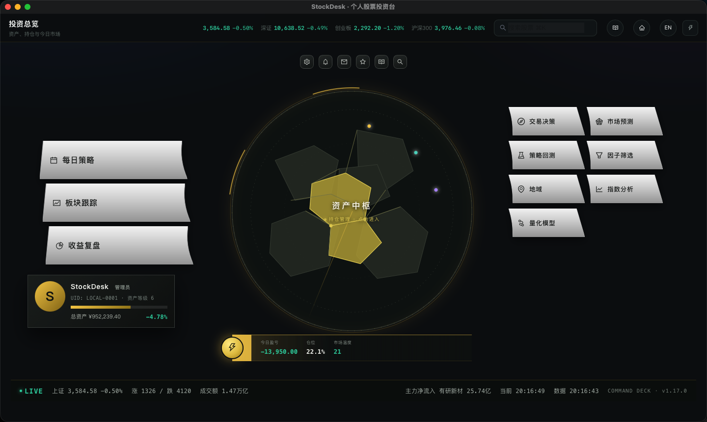
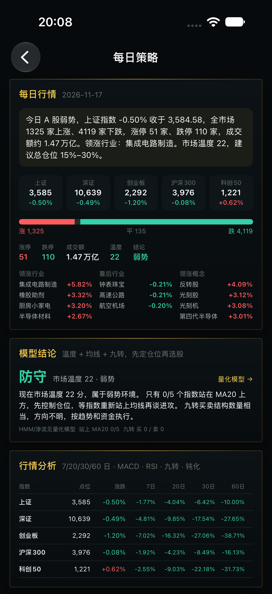
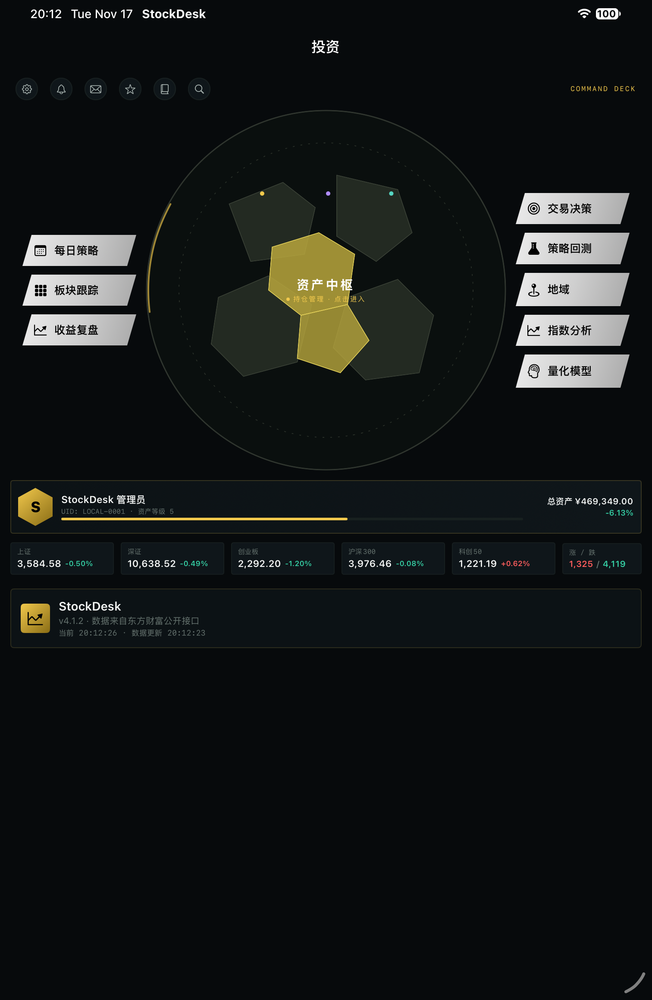

# 本地构建与验证 · Local Build & Verification

> 更新时间：2026-11-17 · 基线：**桌面端 1.17.0 / iOS 4.1.2 (36)**
>
> 这个目录是 StockDesk 的本地可构建副本。源码已与上游 `main` 同步，并额外做了稳定性、测试、iPad 显示与打包流程的加固。所有产物集中在 `release/`。

## 本次本地优化 / What changed locally

### 后端 / Backend

- **SQLite 连接泄漏修复**：`with sqlite3.connect(...)` 只提交/回滚，并不会关闭连接；旧代码在行情轮询下会持续累积文件描述符。新增 `db.session()` / `db._db()`，保证提交、异常回滚、`close()` 三步齐全；`portfolio.py`、`repo.py` 全部改为使用它。
- **WAL + busy timeout**：用户库和缓存库启用 WAL，连接设置 5s busy timeout，WebSocket 与 REST 并发读写不再直接报 `database is locked`。
- **缓存写入兜底**：行情计算偶发 `NaN/Infinity` 时，原来的 `allow_nan=False` 会让整次缓存写入抛错并变成 500。现在会递归把非有限数值转成 `null`，保留其余字段。
- **FastAPI lifespan**：移除重复且已废弃的 `on_event("startup")`，统一到 lifespan，启动只初始化一次数据库。
- **缓存清理接口**：新增 `db.cache_clear(prefix)`，方便排查行情缓存问题。
- **前端版本号单一来源**：HUD、设置、使用指南、版本比对原先硬编码 `1.16.0`，与服务端 1.17.0 不一致并触发首次加载自动刷新。现在 Vite 构建时从 `backend/config.py` 注入 `__APP_VERSION__`。

### 测试与接口 / Tests & API

- 新增 `tests/`（pytest，23 项）：SQLite 设置/缓存/TTL/NaN/文件描述符、持仓移动成本、卖出校验、FIFO 已实现盈亏、全部回测策略信号、回测结果 JSON 可序列化、账户/交易/自选/回测/SPA 的 API 行为。
- 新增 `scripts/api_smoke.py`：真实启动服务后的端到端冒烟，覆盖全部只读接口、3 个写接口、SPA 首页与入口 JS。
- CI 增加 `pytest` 与 `ruff --select F,E9`，并清理了未使用变量/多余 f-string。

### iOS / iPad

- 版本号改为从 `Info.plist`（即 `project.yml` 的 `MARKETING_VERSION`）读取，不再在 HUD / 交易决策页手写 `4.1.2`，避免发版后版本显示不一致。
- iPad HUD 中枢放大（Pro 480pt / mini 420pt），并在管理员卡片下增加指数与涨跌家数状态条，利用 iPad 的纵向空间；iPhone 布局不变。
- 新增 `ios/build_ios.sh`：一条命令生成模拟器 `.app` 与未签名真机 `.ipa`，产物带版本号与 SHA-256。

### 构建与发版 / Build

- `stockdesk.spec` 的 `CFBundleShortVersionString` / `CFBundleVersion` 直接从 `backend/config.py` 读取；`package_macos.sh` 的默认版本也来自同一处，`VERSION=x.y.z` 仍可覆盖。
- `build_app.sh` 会自动查找 `.venv`、`../.venv`、`../../.venv`，与 `package_macos.sh` 行为一致，并修正步骤编号。
- 新增 `scripts/verify_release.py`：校验 `release/` 里各平台产物、版本、SHA-256 与压缩包内容。

## 验证记录 / Verification

以下命令在本机 macOS 26（Apple Silicon）、Xcode 27.2、Python 3.13、Node 23 上实际执行：

| 检查 | 命令 | 结果 |
| --- | --- | --- |
| 后端单测 | `.venv/bin/python -m pytest -q tests` | 23 passed |
| 静态检查 | `ruff check desktop/backend us tests --select F,E9` | All checks passed |
| 前后端构建 | `cd desktop/frontend && npm run build` | 3631 modules，构建成功 |
| 原生 C++ 核心 | `cd desktop && python setup.py build_ext --inplace` | `_native` 编译成功，`/api/health` 显示 `C++` |
| API 冒烟 | `python scripts/api_smoke.py http://127.0.0.1:<port>` | 全部接口通过（含 PUT 账户、回测、选股、SPA 资源） |
| macOS 打包 | `cd desktop && ./package_macos.sh` | DMG + ZIP 生成，App 内启动并通过 `/api/health`，HUD 显示 v1.17.0 |
| iOS 模拟器 | `cd ios && ./build_ios.sh --simulator` | `BUILD SUCCEEDED`；iPhone 18 Pro / iPad Pro 11" / iPad mini 实机截图验证 |
| iOS 真机 IPA | `cd ios && ./build_ios.sh` | 未签名 IPA 生成（需自行重签） |
| Windows | 官方 1.17.0 CI 产物 | 已在 Windows Server 2022 / Windows 10/11 完成打包与健康检查（上游 CI）；SHA-256 与官方 `SHA256SUMS-windows.txt` 完全一致 |

## 本机截图 / Screenshots



| iPhone · 每日策略 | iPad mini · HUD |
| --- | --- |
|  |  |

## 产物 / Artifacts

| 文件 | 平台 | 说明 |
| --- | --- | --- |
| `release/StockDesk-macOS-1.17.0.dmg` | macOS 12+ Apple Silicon | 打开后运行 `Install-StockDesk.command` |
| `release/StockDesk-macOS-1.17.0.zip` | macOS | 解压后打开 `StockDesk.app` |
| `release/StockDesk.exe` | Windows 10/11 x64 | 官方 1.17.0 CI 构建（含 WebView2 冒烟） |
| `release/StockDesk-iOS-4.1.2-unsigned.ipa` | iPhone / iPad iOS 17+ | 未签名，需 Sideloadly / AltStore / Xcode 重签 |
| `release/StockDesk-simulator.app.zip` | iOS 模拟器 | 解压后 `xcrun simctl install` |
| `release/SHA256SUMS.txt` | 全部 | 校验和 |
| `release/verification.json` | 全部 | 本次构建/测试/截图的机器可读记录 |
| `release/README.md` | 全部 | 安装与校验说明 |

## 从源码运行

```bash
# 1. Python 依赖（建议 3.10+；本机用 3.13 验证）
python3 -m venv .venv
source .venv/bin/activate
pip install -r desktop/requirements.txt

# 2. 前端
cd desktop/frontend && npm ci && npm run build && cd ../..

# 3. 启动（原生窗口）
cd desktop && python main.py
# 或只跑服务：
python main.py --headless
```

数据默认在 `desktop/data/`（源码运行）或 `~/Library/Application Support/StockDesk/`（打包版）；可用 `STOCKDESK_DATA=/path` 覆盖。原有账户/交易数据已保留。

## 重新打包

```bash
# macOS：DMG + ZIP + SHA-256
cd desktop && ./package_macos.sh

# iOS：模拟器 .app + 未签名 .ipa
cd ios && ./build_ios.sh

# 只构建模拟器（快速验证）
cd ios && ./build_ios.sh --simulator
```

## 限制

- macOS 包仅含 Apple Silicon（arm64）；Intel Mac 请从源码运行。
- macOS App 为 ad-hoc 签名，首次打开需按提示放行或执行 `xattr -dr com.apple.quarantine`。
- iOS IPA 未签名，必须用自己的 Apple ID 重签；免费签名 7 天有效。
- Windows `StockDesk.exe` 为上游 CI 构建（本机无法在 macOS 上交叉编译 Windows 原生包）；本目录的桌面源码改动会在下次 Windows CI 构建时生效。
- 行情来自东方财富公开接口，仅供研究，不构成投资建议。
