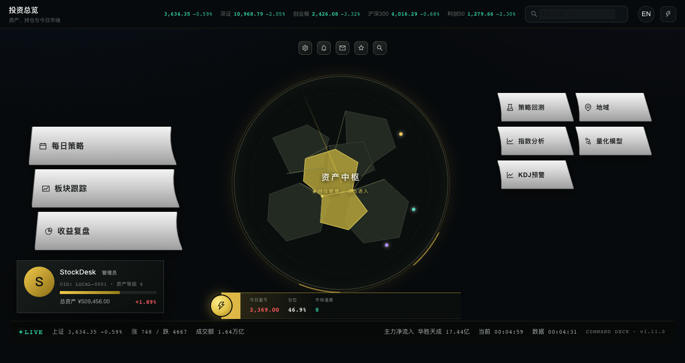
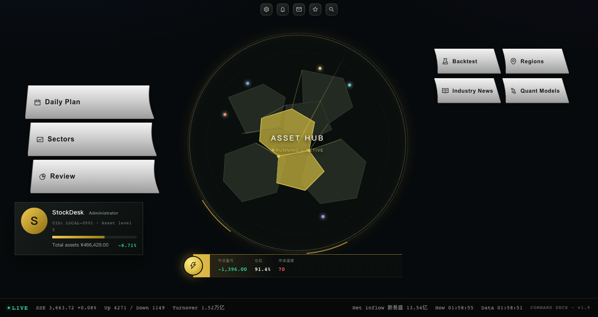

# StockDesk · akshare

[](LICENSE)
[](desktop/backend)
[](desktop/frontend)
[](ios)
[](us/static)

**个人股票投资台 / Personal equity investment desk**  
Mac · Windows · iOS · US Equities

[中文](#中文) · [English](#english) · [US Edition](docs/US-MARKET.md) · [Website](https://cxy2696.github.io/stockdesk-akshare/) · [Guide](docs/GUIDE.md) · [Languages](LANGUAGES.md) · [Architecture](docs/ARCHITECTURE.md) · [Install](docs/INSTALL.md) · [Releases](https://github.com/cxy2696/stockdesk-akshare/releases/tag/v1.10.0) · [Container](https://github.com/cxy2696/stockdesk-akshare/pkgs/container/stockdesk-akshare-us)

## 项目展示页 / Project site

**https://cxy2696.github.io/stockdesk-akshare/**

一个独立的项目主页：43 秒产品影片、五章放映、背景音乐、HUB / 量化模型 / 美股 / iOS 界面、版本入口和快速开始。页面支持中英切换。

An independent project site with a 43-second product film, five screening chapters, background music, the HUB / models / US / iOS views, editions and a quick start. It has a Chinese / English switch.





---

## 中文

### 项目简介

StockDesk 是一个本地优先、单用户的股票投资工作台。它把持仓、行情、复盘、策略、HMM/渗流模型和地域/行业数据放在一个 HUD 风格的界面里，账户与行情缓存只保存在本机。

最新版本 **1.10.0** 新增 KDJ 极值预警：半导体、通信设备与五个 A 股指数，5 分钟 / 30 分钟双周期，绘制近似中枢。

本仓库是 **stockdesk-akshare** 项目文档与源码整理版，包含：

- **macOS 原生 App**：pywebview + WebKit 独立窗口
- **Windows 单文件 exe**：pywebview + Edge WebView2 独立窗口
- **iOS App**：SwiftUI + Swift Charts
- **US 美股版**：独立 FastAPI + ECharts 仪表盘

> 本仓库是独立副本，不修改、不启动、不影响当前本地正在使用的 StockDesk。

### 功能

| 模块 | 说明 |
| --- | --- |
| HUD 指挥舱 | 资产中枢、7 个核心入口、管理员名片、状态栏 |
| 持仓与复盘 | 交易流水、成本、已实现/浮动盈亏、净值、回撤 |
| 每日策略 | 市场状态、仓位建议、标的选择 |
| 板块跟踪 | 行业/概念板块、上涨广度、个股热图 |
| 策略回测 | 均线、动量、RSI 等规则回测 |
| 量化模型 | 5 个 A 股指数 3 状态 HMM、渗流最大连通簇、行业临界、个股仓位建议 |
| 地域 | 中国上市公司地图、省份分布、省份龙头 |
| 行业要闻 | 行业新闻与关键标的 |
| 图片分享 | 进入子页面后分享当前页面长图 |
| 缩放 | 100% / 120% / 150%，文字自动换行、增行 |
| KDJ 预警 | 半导体 / 通信设备 / 指数，5m + 30m 中枢与 J 极值 |

### 快速开始

想先看完整使用流程？[使用教程与流程](docs/GUIDE.md) 把第一次打开、每天的使用顺序、数据备份和发布流程都写在一起。

#### macOS

```bash
cd desktop
python3 -m venv .venv && source .venv/bin/activate
pip install -r requirements.txt
cd frontend && npm ci && npm run build && cd ..
python main.py
```

开发和调试也可以直接打开浏览器：

```bash
python main.py --browser
```

#### Windows

```bash
cd desktop
py -3.10 -m venv .venv
.venv\Scripts\pip install -r requirements.txt
cd frontend && npm ci && npm run build && cd ..
python main.py
```

单文件构建见 [docs/INSTALL.md](docs/INSTALL.md)。

#### iOS

```bash
cd ios
xcodegen generate
open StockDesk.xcodeproj
```

选择自己的开发团队后运行。数据保存在 App 本地；不依赖 Mac 后端。

#### 美股版

```bash
cd us
python -m venv .venv && source .venv/bin/activate
pip install -r requirements.txt
python run.py
```

打开 `http://127.0.0.1:8770`。详见 [docs/US-MARKET.md](docs/US-MARKET.md)。

### 数据源

- A 股/指数：东方财富公开行情接口
- 美股：东方财富美股公开行情接口（列表、报价、日 K）
- 本项目以 HTTP 直连为主；`akshare` 可作为后续可选适配层

所有行情仅用于研究，不构成投资建议。

### 缩放原则

- 只放大文字字号，不拉伸地图/固定图形
- 按键高度自动增加，卡片/表格自动换行、增行
- 120% / 150% 下隐藏行情 ticker，标题与副标题完整显示
- iOS 150% 自动切换单列 HUB

### 仓库结构

```
stockdesk-akshare/
├── desktop/        FastAPI + React 桌面端源码
├── ios/            SwiftUI iOS 源码
├── us/             美股独立仪表盘
├── docs/           架构、安装、美股版、FAQ
├── screenshots/    Mac / iOS / US 截图
└── .github/        CI
```

### 版本

- macOS：1.9.0
- iOS：3.6 (27)
- US：1.0.0

### 免责声明

本项目不提供投资建议。行情可能延迟、缺失或错误；据此交易的风险由使用者自行承担。

---


## English

### What is this?

StockDesk is a local-first, single-user equity research desk. It combines portfolio tracking, market data, review analytics, strategy backtests, HMM/percolation models, and regional/industry views in a HUD-style interface. Account data and caches stay on your machine.

This repository, **stockdesk-akshare**, is the documented source snapshot for:

- **macOS app** — pywebview + WebKit native window
- **Windows single-file exe** — pywebview + Edge WebView2 native window
- **iOS app** — SwiftUI + Swift Charts
- **US edition** — standalone FastAPI + ECharts dashboard

> This is an independent copy. It does not modify, launch, or interfere with the StockDesk installation you are currently using.

### Features

| Module | Description |
| --- | --- |
| HUD | Asset hub, seven entries, admin plate, live status bar |
| Portfolio | Trades, cost basis, realized/unrealized P&L, NAV, drawdown |
| Daily plan | Market regime, position sizing, candidate selection |
| Sectors | Industry/concept boards, breadth, stock heatmap |
| Backtest | MA cross, momentum, RSI and other rule tests |
| Quant models | 3-state HMM on five A-share indices, percolation giant component, industry criticality, per-stock position advice |
| Regions | China listed-company map, province distribution and leaders |
| Industry news | Sector news and key names |
| Image sharing | Full-page share image after entering a detail page |
| Scaling | 100% / 120% / 150%, text reflows and rows grow automatically |

### Quick start

Want the full walkthrough? [Guide & Workflow](docs/GUIDE.md) covers first launch, the daily routine, backups and the release flow.

#### macOS

```bash
cd desktop
python3 -m venv .venv && source .venv/bin/activate
pip install -r requirements.txt
cd frontend && npm ci && npm run build && cd ..
python main.py
```

Browser-only development:

```bash
python main.py --browser
```

#### Windows

```bash
cd desktop
py -3.10 -m venv .venv
.venv\Scripts\pip install -r requirements.txt
cd frontend && npm ci && npm run build && cd ..
python main.py
```

See [docs/INSTALL.md](docs/INSTALL.md) for the one-file build.

#### iOS

```bash
cd ios
xcodegen generate
open StockDesk.xcodeproj
```

Select your development team and run. Data is local to the app; no Mac backend is required.

#### US edition

```bash
cd us
python -m venv .venv && source .venv/bin/activate
pip install -r requirements.txt
python run.py
```

Open `http://127.0.0.1:8770`. See [docs/US-MARKET.md](docs/US-MARKET.md).

### Data sources

- A-shares and indices: Eastmoney public endpoints
- US equities: Eastmoney US public endpoints (list, quote, daily candles)
- Direct HTTP is used today; `akshare` can be added as an optional adapter

Market data is for research only and is not investment advice.

### Scaling principles

- Font size changes only; maps and fixed graphics are not stretched
- Buttons grow in height; cards and tables wrap/grow rows
- Ticker hides at 120%/150% so titles and subtitles remain complete
- iOS switches the HUB to a single column at 150%

### Layout

```
stockdesk-akshare/
├── desktop/        FastAPI + React desktop source
├── ios/            SwiftUI iOS source
├── us/             Standalone US dashboard
├── docs/           Architecture, install, US edition, FAQ
├── screenshots/    Mac / iOS / US screenshots
└── .github/        CI
```

### Desktop details / 桌面端详情

See [desktop/README.md](desktop/README.md) for the full HUB guide, screenshots, build steps and module descriptions.

桌面端完整说明、交互截图、构建步骤与模块介绍：[desktop/README.md](desktop/README.md)

### Releases & Packages

- **Releases**: https://github.com/cxy2696/stockdesk-akshare/releases/tag/v1.10.0
- **macOS**: `StockDesk-macOS-1.9.0.zip`
- **Windows**: `StockDesk-Windows-1.9.0.exe`
- **iOS**: `StockDesk-iOS-3.6-unsigned.ipa`
- **A-share container**: `ghcr.io/cxy2696/stockdesk-akshare-a-share:latest`
- **US container**: `ghcr.io/cxy2696/stockdesk-akshare-us:latest`

```bash
# A-share web app (port 8765)
docker run --rm -p 8765:8765 -v stockdesk-data:/data ghcr.io/cxy2696/stockdesk-akshare-a-share:latest

# US dashboard (port 8770)
docker run --rm -p 8770:8770 ghcr.io/cxy2696/stockdesk-akshare-us:latest
```

### Versions

- macOS: 1.10.0
- iOS: 3.6 (27)
- US: 1.0.0

### Disclaimer

Not investment advice. Quotes may be delayed, missing, or incorrect. Trading decisions and risk remain yours.

### License

MIT License. See [LICENSE](LICENSE).

