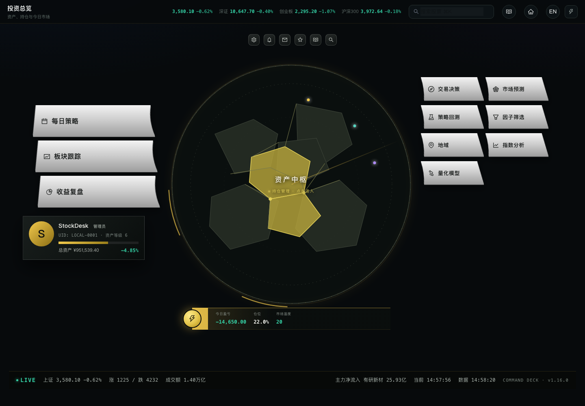
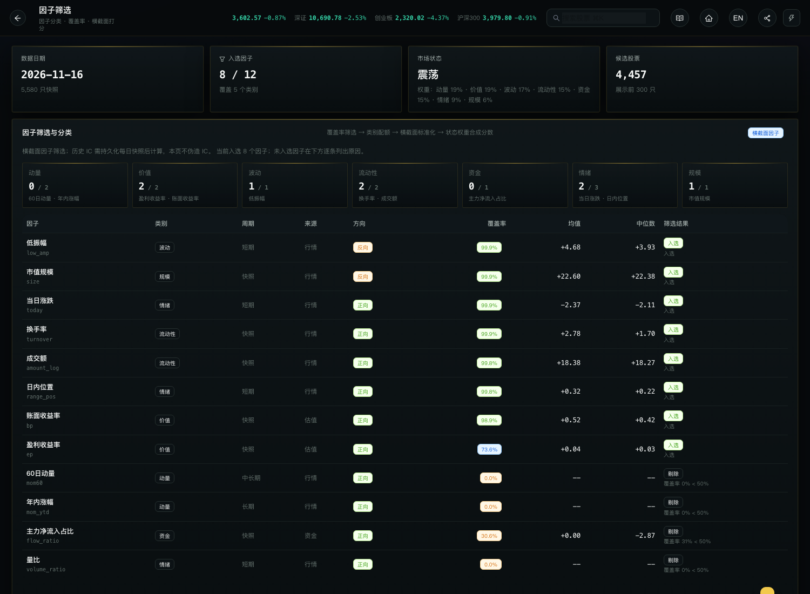
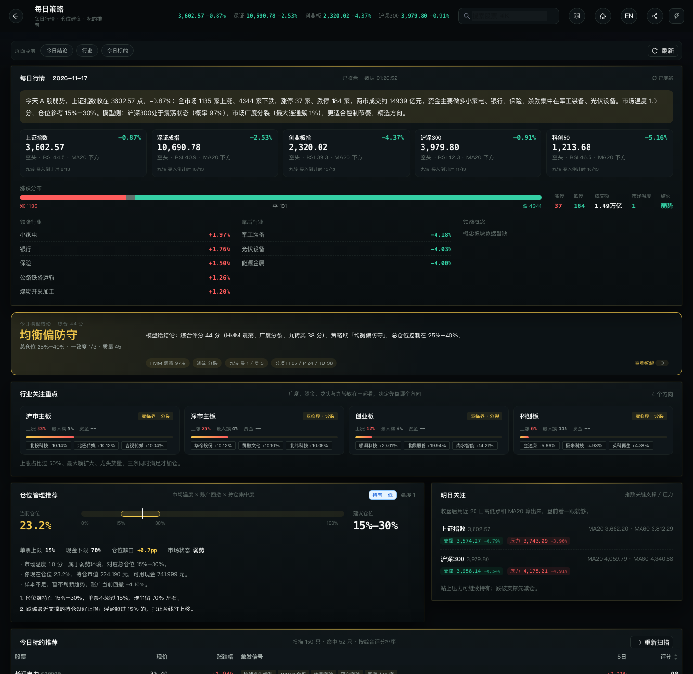
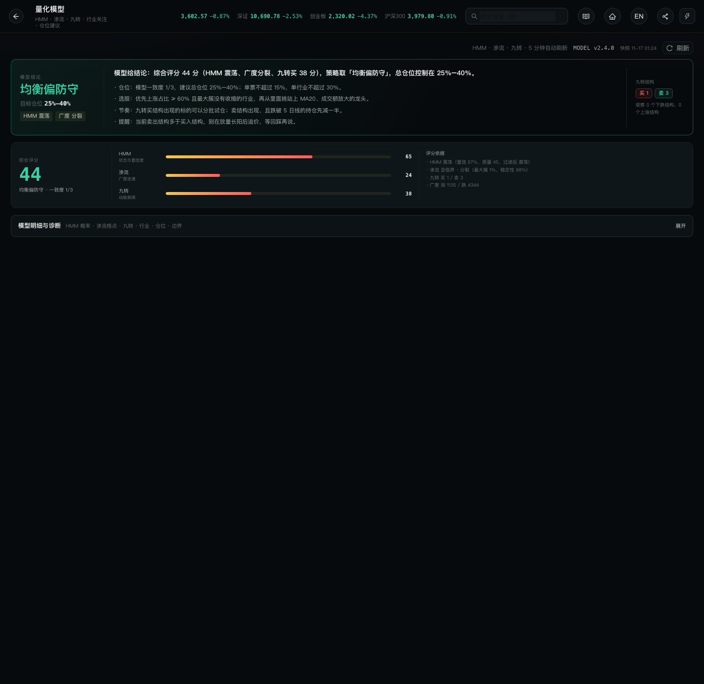
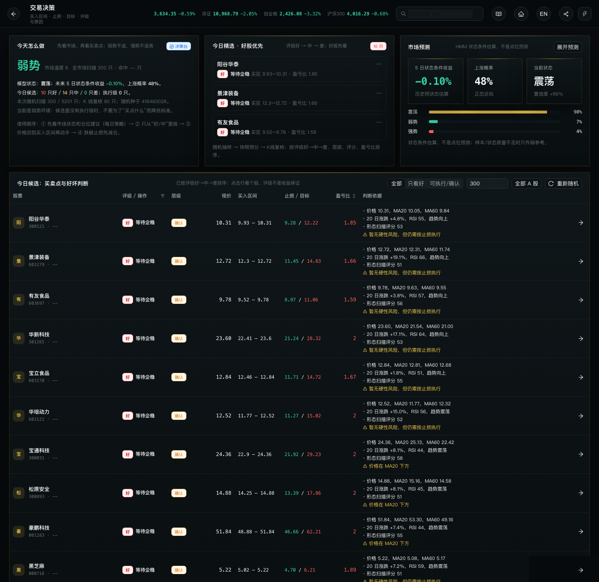
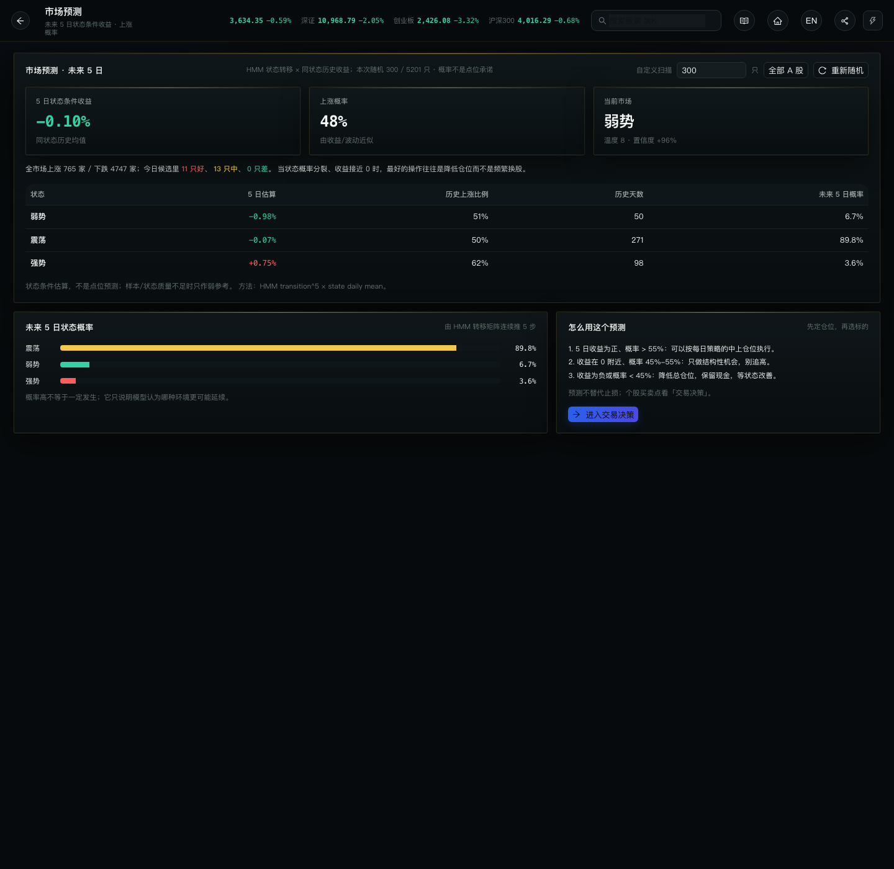

# StockDesk · akshare

[](LICENSE)
[](desktop/backend)
[](desktop/frontend)
[](ios)
[](us/static)

**个人股票投资台 / Personal equity investment desk**  
Mac · Windows · iPhone · iPad · US Equities

[使用指南](docs/GUIDE.md) · [安装构建](docs/INSTALL.md) · [模型说明](docs/MODELS.md) · [Ollama 指南](docs/OLLAMA.md) · [Releases](https://github.com/cxy2696/stockdesk-akshare/releases) · [English](#english)



> 截图来自 1.17.0：精简后的 HUD、每日策略、交易决策、市场预测、因子筛选与个股页。

> **1.17.0 桌面端（源码/本地构建） / 1.17.0 安装包 / iOS 4.1.2**：本轮精简各页阅读负担，把高级图表、资金、要闻、筹码和参数说明收进“更多数据/高级设置”；功能不删，只减少默认可见内容。Releases 安装包已同步为 1.17.0。

> **本地构建（2026-11-17）**：本目录已与上游 `main` 同步，并完成 SQLite 连接/并发加固、后端测试与 API 冒烟、iPad HUD 增强和跨端打包脚本整理。各端产物在 [`release/`](release/README.md)，完整变更与验证记录见 [LOCAL.md](LOCAL.md)。

## 下载 / Download

| 平台 Platform | 文件 File | 版本 Version | 说明 Notes |
| --- | --- | --- | --- |
| macOS 12+ Apple Silicon | `StockDesk-macOS-1.17.0.dmg` / `.zip` | 1.17.0 | 打开 DMG，双击 `Install-StockDesk.command` |
| Windows 10/11 x64 | `StockDesk.exe` | 1.17.0 | 双击；需要 WebView2 |
| iPhone / iPad iOS 17+ | `StockDesk-iOS-4.1.2-unsigned.ipa` | 4.1.2 | 用 Sideloadly / AltStore / Xcode 重签 |
| 浏览器 / NAS | GHCR 容器 | latest | 见 [PACKAGES](docs/PACKAGES.md) |
| 源码 | `main` 分支 | **1.17.0** | 见下方快速开始；本地构建/打包流程不变 |
| 本地产物 | `release/` | 1.17.0 / 4.1.2 | 已在本机验证的 DMG / ZIP / IPA / 模拟器 App |

- 安装包在 [Releases](https://github.com/cxy2696/stockdesk-akshare/releases)；macOS 用 `SHA256SUMS-macOS.txt` 校验。
- macOS App 为 ad-hoc 签名，下载后需运行安装脚本清除 `com.apple.quarantine`。脚本被拦截时右键 → 打开；手动命令：
  ```bash
  xattr -dr com.apple.quarantine /Applications/StockDesk.app
  ```
- macOS 仅 Apple Silicon；Intel Mac 请从源码运行或使用容器。iOS IPA 未签名，必须重签。

## 这是什么 / What it is

StockDesk 是一个本地优先、单用户的股票投资工作台：持仓、行情、复盘、策略回测、HMM/渗流/九转模型、量化决策和地域/行业数据，都在一个 HUD 风格界面里。账户和缓存只保存在本机。

A local-first, single-user equity desk: portfolio, quotes, review, backtests, HMM/percolation/TD models, decision/market-forecast views and regional/industry views in one HUD. Account data and caches stay on your machine.

> 本仓库是独立副本，不影响你当前本地正在使用的 StockDesk。<br>
> This is an independent snapshot and does not affect your existing StockDesk install.

## 1.17.0 更新 / What's new

- **减少默认阅读量**：每日策略只保留今日结论、行业、仓位建议、明日关注和今日标的；模型明细、资金热点、要闻、指标说明收进折叠区。
- **交易决策**：去掉重复的“今日精选/市场预测”两张卡和底部说明，改成一条市场摘要 + 候选表；判断依据最多两行。
- **量化模型**：默认只显示结论、综合评分和一条“模型明细与诊断”；HMM/渗流/九转/行业/仓位明细按需展开。
- **收益复盘**：去掉重复的行情判断、市场情况和仓位建议；保留 KPI、净值/回撤、风险与月度；交易统计与平仓明细折叠。
- **持仓 / 自选 / 个股**：持仓总览去掉重复的资金流水/盈亏结构/仓位结构卡；自选默认只显示 7 列，高级估值列可切换；个股的九转、筹码、黄金分割、公司/财务折叠。
- **指数 / 地域 / 设置**：指数卡片只保留点位、周期和详细指标入口；地域把全部省份列表折叠；设置页把 Ollama、参数口径、名片和关于折叠。
- **数据与刷新**：页面继续按接口取数；HUD 侧栏显示数据刷新时间，每日策略 3 分钟、自选 45 秒、模型 5 分钟、指数 3 分钟自动刷新；设置页可手动刷新状态。

## 1.15.0 历史更新 / Previous

- **因子筛选与分类**：新增「因子筛选」页。按覆盖率筛选因子，按类别（动量/价值/波动/流动性/资金/情绪/规模）、周期、来源、方向分类；用市场状态权重合成横截面分数，并按评级/市场过滤候选。当前不伪造历史 IC，界面会明确标注“横截面因子”。
- **回测基准**：默认基准改为 **上证指数 000001**；可切换深证成指、创业板指、沪深300、科创50或“买入并持有”。新增基准曲线、超额收益、跟踪误差、信息比率，并写入回测结果。
- **界面更新**：`/` 与 `/assets` 使用 `no-store`；前端比较服务端版本，升级后自动重载，避免窗口停留在旧 UI。
- **数据日期**：快照日期在开盘前/周末自动显示最近交易日，不再把昨收标成今天；因子页、回测结果与行情日期一致。
- **分类与导航**：HUD 右侧与主导航新增「因子筛选」入口；设置页版本更新为 1.15.0。







## 1.17.0 历史更新 / Previous

- **C++ 模型核心**：新增 `desktop/backend/native.cpp`（C++17 + pybind11）：2D 格点 union-find 渗流 + 单变量 Gaussian HMM Baum-Welch；Python 负责数据、参数和展示，未编译时自动 NumPy 回退。 本机 420 根收益序列的 HMM：C++ 约 2.4 ms，NumPy 回退约 120 ms。
- **覆盖审计**：全市场 5,580 只 = 沪深 5,225 + 北交所 355，缺失 0；`/api/market/coverage` 实时返回总数、板块分布和缺失代码。
- **载入**：桌面端按页懒加载；自选/持仓决策并发；iOS 交易决策 K 线并发 + 12 秒超时，弱网先展示已有结果，不再白屏。
- **引擎可观测**：`/api/health` 返回 `engine.backend = C++`；设置页显示 C++ 核心与全 A 覆盖。

- **交易决策台**：新增「交易决策」页。每只候选给出 **评级好/中/差、操作、层级执行/确认/预警/观察、买入区间、止损、目标、盈亏比、判断依据与风险**；候选按 **好→中→差** 排序，右侧“今日精选”优先展示好股。
- **市场预测**：新增「市场预测」页。HMM 状态转移推未来 5 日状态概率，再混合各状态历史收益/波动，输出 5 日状态条件收益与上涨概率；明确不是点位预测。
- **可调随机扫描数量**：市场预测/交易决策支持从 **30 只到全部 A 股**（5200+）自定义随机抽样；桌面/Windows 可输入数量、点击“全部 A 股”和“重新随机”，设置保存在本机。
- **个股买卖点**：个股详情顶部新增决策卡，按价格/MA20/MA60/RSI/九转/资金/市场状态生成同一口径的买卖点与评级。
- **持仓 / 自选判断**：持仓表新增好坏判断与执行层级；自选表新增评级、执行层级、买区、止损/目标、盈亏比与原因。
- **导航与排版**：右上角新增一键返回首页按钮；HUD 增加交易决策/市场预测入口；顶栏标题区加宽，减少指数 ticker 挤压；决策页改为“今日怎么做 / 今日精选 / 市场预测”三栏。
- **参数解释**：设置页新增“参数、评级与风控说明”，逐项解释设置、评级触发与仓位/止损口径；使用指南新增第 9 章。
- **模型注册表 2.4.0**：新增 native 引擎（1.0.0）；HMM / 渗流热路径由 C++ 执行，NumPy 自动回退。
- **iOS 4.1.2**：原生「交易决策」页继续支持 HMM 5 日预测、持仓/自选评级、买区/止损/目标/盈亏比；K 线并发拉取并加超时，弱网不再无限停在加载页；iPad 横向双列。
- **Windows 1.17.0**：GitHub Actions 构建并发布新的 `StockDesk.exe`。
- **文档与截图**：新增交易决策、市场预测、个股决策、iOS 决策截图；桌面 1.17.0 / iOS 4.1.2。





## 功能 / Features

| 模块 | 说明 |
| --- | --- |
| HUD 指挥舱 | 中央资产中枢 → 持仓管理；左侧 3 个入口；右侧 6 个模块（交易决策、市场预测、回测、地域、指数分析、量化模型）；LIVE 状态条；管理员名片 |
| 每日策略 | 行情、模型结论、主力追踪、行情分析、九转、行业关注、行业要闻、仓位建议、明日支撑压力、今日标的 |
| 交易决策 | 评级好/中/差、执行/确认/预警/观察、买入区间、止损/目标、盈亏比、判断依据与风险 |
| 因子筛选 | 覆盖率筛选、因子分类、状态权重横截面打分、候选过滤；不伪造历史 IC |
| 市场预测 | 未来 5 日状态条件收益、上涨概率、未来状态概率；不是点位预测 |
| 持仓管理 | 持仓总览、资产分析、投资建议、交易流水；移动成本、已实现/浮动盈亏、支撑压力、FIFO、每只持仓的好坏判断/操作/层级/盈亏比 |
| 收益复盘 | 净值/回撤、20/60 日均线、双基准、月度热力图、仓位现金、交易统计 |
| 自选与个股 | 实时行情、日/周/月 K、MACD、九转、筹码、黄金分割、支撑压力；自选评级/执行层级/买卖点；个股交易决策卡 |
| 板块跟踪 | 行业/概念、市场情绪、涨停池、可交互个股热图、形态选股 |
| 策略回测 | 10 套策略、手续费/印花税/滑点、资金曲线、交易明细；默认上证指数基准，可切换指数/买入持有 |
| 量化模型 | 5 指数 3 状态 HMM、渗流最大连通簇、九转结构、综合评分、行业关注、个股仓位建议 |
| Ollama 辅助 | 仅 macOS / Windows；本机模型生成结构化第二意见，默认关闭，可配地址/模型/温度/超时 |
| 指数分析 | A 股 12 个宽基 + 海外指数：趋势、均线、RSI、MACD、支撑压力与结论 |
| 地域与行业 | 中国上市公司地图、34 个省级行政区切换、省份龙头、行业要闻（已并入每日策略） |
| 使用指南 | 10 章：上手、每日流程、页面地图、指标词典、仓位风控、数据隐私、快捷键、FAQ、交易决策、版本 |
| 分享与缩放 | 子页面长图分享；100% / 120% / 150% 文字缩放，自动换行 |
| iOS / iPad | SwiftUI 原生；HUB 直接进持仓管理、指数分析入口、三列主力追踪、九转卡片、持仓快捷入口 |

English modules: HUD, Daily Plan, Trade Decision, Market Forecast, Portfolio (overview/analysis/advice/trades), Watchlist/Stock Detail, Sectors, Backtest, Quant Models, Index Analysis, Regions, Guide, Sharing & Scaling.

## 快速开始 / Quick start

```bash
# macOS / Linux
cd desktop
python3 -m venv .venv && source .venv/bin/activate
pip install -r requirements.txt
cd frontend && npm ci && npm run build && cd ..
python main.py            # 原生窗口；--browser 用浏览器
```

```powershell
# Windows
cd desktop
py -3.10 -m venv .venv
.venv\Scripts\pip install -r requirements.txt
cd frontend && npm ci && npm run build && cd ..
python main.py
```

```bash
# iOS
cd ios && xcodegen generate && open StockDesk.xcodeproj
# US edition
cd us && python -m venv .venv && source .venv/bin/activate
pip install -r requirements.txt && python run.py
```

完整步骤、打包与发版见 [安装构建](docs/INSTALL.md)；第一次使用见 [使用指南](docs/GUIDE.md)。

## 数据与缩放 / Data & scaling

- A 股/指数：东方财富公开行情接口；美股：东方财富美股公开接口；HTTP 直连，`akshare` 用于部分分钟线/板块回退；东方财富不可用时自动回退新浪日线/资金流。
- 单飞锁避免同一时刻重复下载全市场快照；东方财富连续失败会短暂熔断，页面不会卡在超时上。
- 缩放只改文字：按钮/卡片自动增高，表格自动换行；地图和图表不拉伸；120%/150% 隐藏 ticker；iOS 150% 单列 HUB。
- 所有行情仅用于研究，不构成投资建议。

## 项目结构 / Layout

```
stockdesk-akshare/
├── desktop/        FastAPI + React 桌面端
│   ├── backend/    market / portfolio / models / td / daily / api
│   └── frontend/   HUB、每日策略、持仓管理、指数分析、模型、热图
├── ios/            SwiftUI iOS
├── us/             美股独立仪表盘
├── docs/           指南、安装、架构、模型、容器
├── screenshots/    Mac / iOS / US 截图
└── .github/        CI
```

## 版本 / Versions

| 平台 | 版本 |
| --- | --- |
| macOS（源码/本地构建） | **1.17.0** |
| macOS / Windows 安装包 | 1.17.0（Releases） |
| iOS | **4.1.2 (36)** |
| US | 1.0.2 |
| 容器 | `stockdesk-akshare-a-share:1.17.0` / `stockdesk-akshare-us:1.0.2` |

## English

StockDesk is a local-first, single-user equity research desk for macOS, Windows, iOS and the web. It combines portfolio tracking, quotes, review analytics, backtests, HMM/percolation/TD models, decision/market-forecast views and regional/industry views in a HUD-style interface. Account data and market caches stay local.

**Download:** macOS and Windows are updated to 1.17.0; iOS is updated to 4.1.2. Assets are attached to the matching release. The `main` branch matches the installers and can also be built from source with the commands above. macOS is Apple Silicon only; run `Install-StockDesk.command` after downloading to clear Gatekeeper quarantine. Windows needs WebView2; choose More info → Run anyway if SmartScreen blocks it. The iOS IPA is unsigned and must be re-signed.

**1.17.0 highlights:** KDJ alerts are removed from desktop, iOS, backtests, docs and CI; the HUD uses three responsive widths for iPhone, iPad mini and iPad Pro, so the hub no longer falls back to a phone layout on small iPads. HMM, percolation, TD, decision, forecast, factor screening, portfolio and backtests remain.

**Versions:** desktop 1.17.0 · iOS 4.1.2 (36) · US 1.0.2.<br>
**License:** MIT. Market data is for research only, not investment advice.
