# StockDesk · 个人股票投资台

[中文](#中文) · [English](#english)

## 中文

一个为个人投资者打造的**本地优先**股票投资工作台：行情、持仓记账、收益复盘、策略回测、选股与个股筹码分析，全部跑在自己电脑上。
界面默认 **「指挥舱 HUD」**：深色圆形资产中枢、左侧 3 个放大银色斜切按键、右侧 4 个功能模块环绕、管理员名片并入左列下方；三种主题（指挥舱 / 明亮 / 深色）共用同一套 HUB 首页交互，仅切换背景、顶栏和边框配色；支持 **中文 / English** 切换。
数据来自东方财富公开行情接口，账户数据只保存在本地 SQLite 中。界面顶栏可切换 **中文 / English**；HUB、导航、设置与美股版文案已双语化，行情数据保持数据源原文。

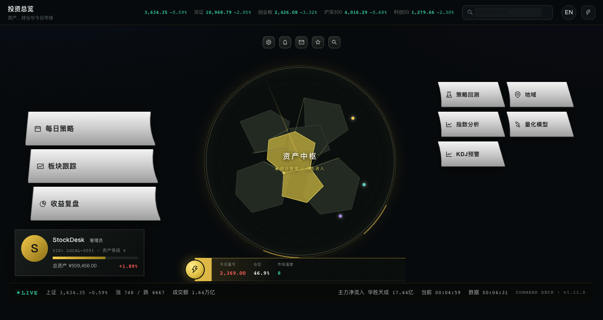

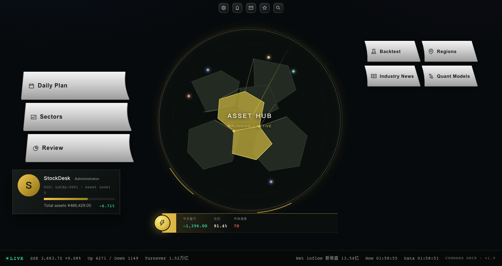

| 120% 字体 | 150% 字体 |
| --- | --- |
|  | 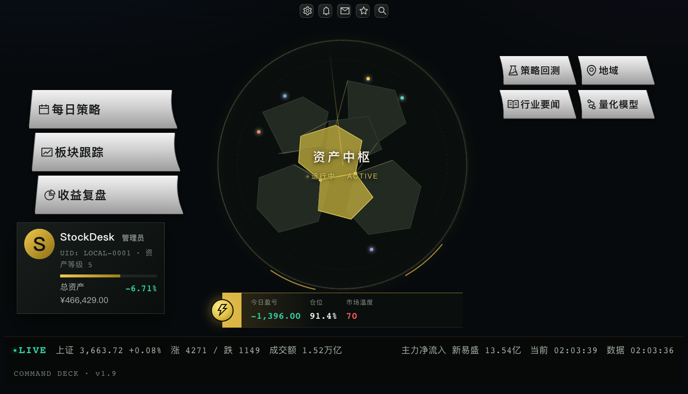 |

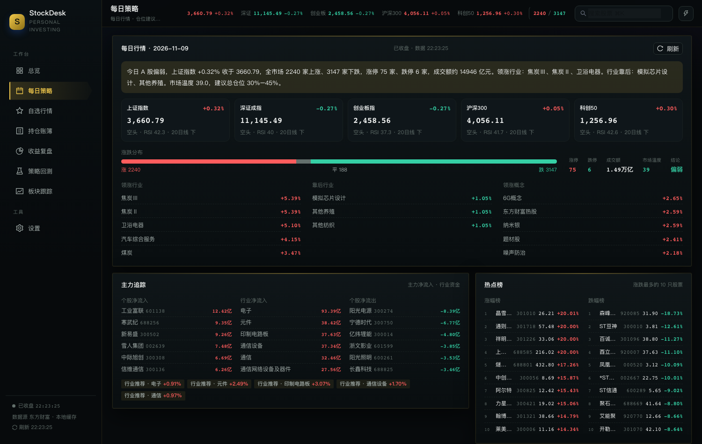

| 持仓账簿（含支撑/压力） | 个股筹码分布 | 收益复盘 |
| --- | --- | --- |
| 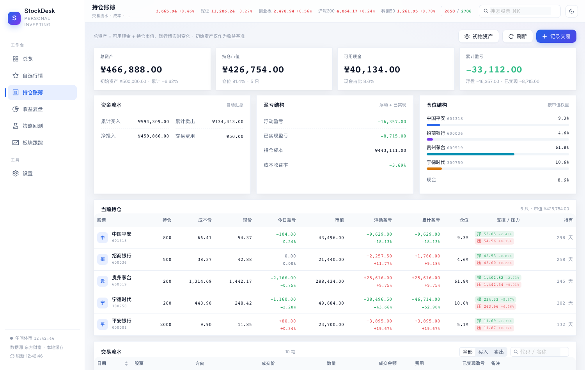 | 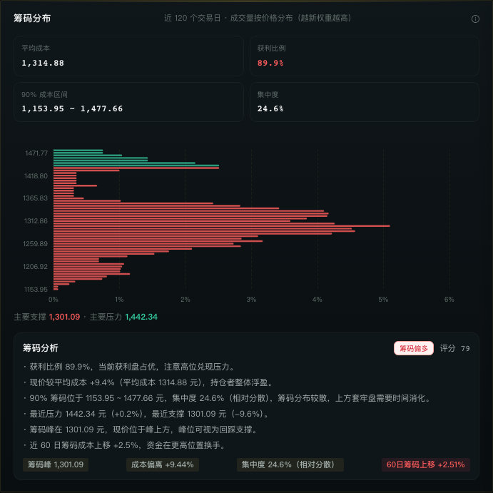 | 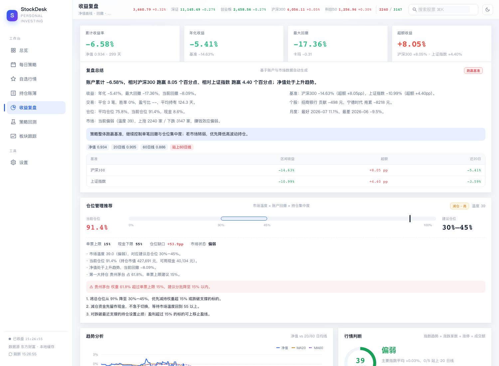 |

| 板块跟踪 | 市场情绪 | 个股热图 |
| --- | --- | --- |
| 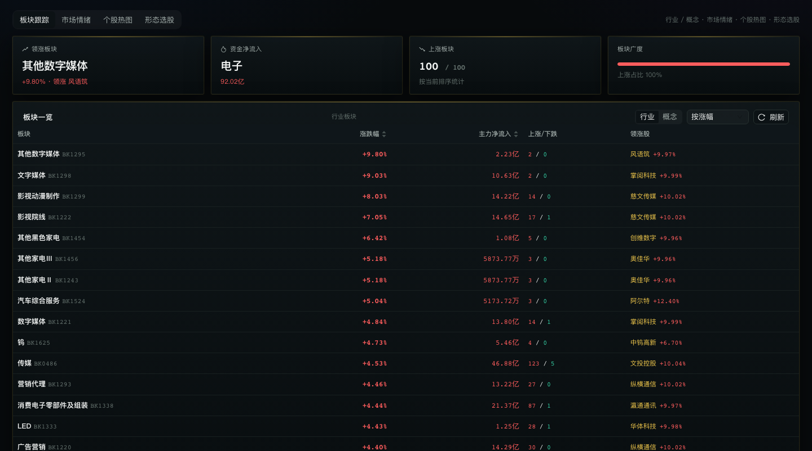 | 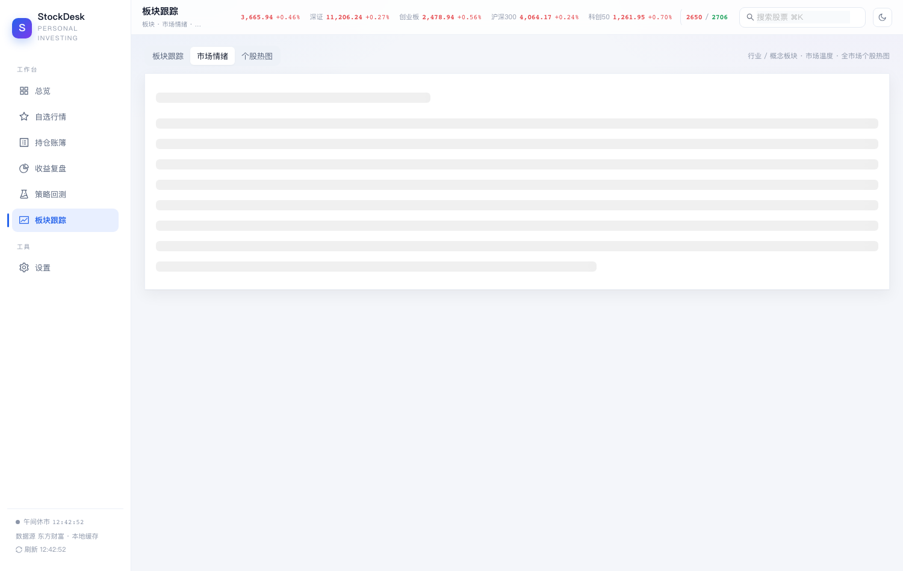 | 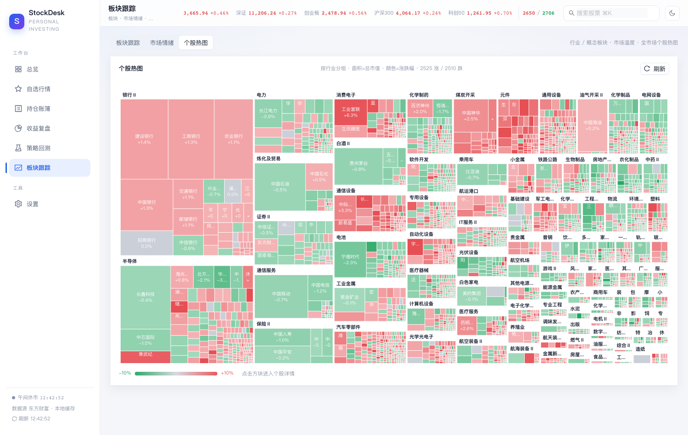 |

| 形态选股（扫描结果） | K 线 MACD + 九转 | 每日策略 |
| --- | --- | --- |
| 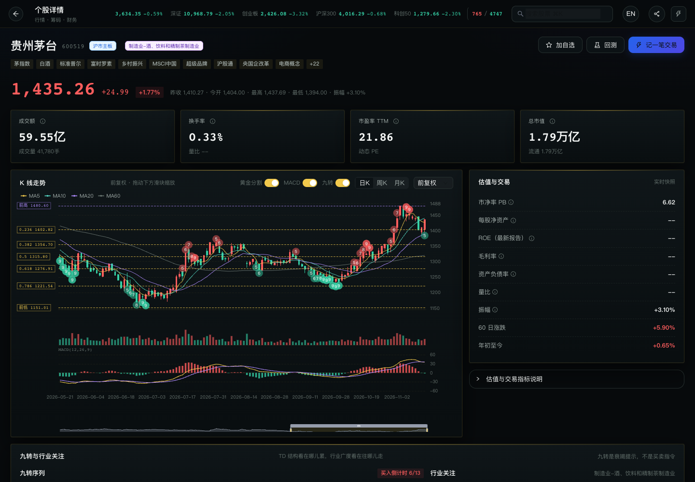 |  |  |

### 量化模型

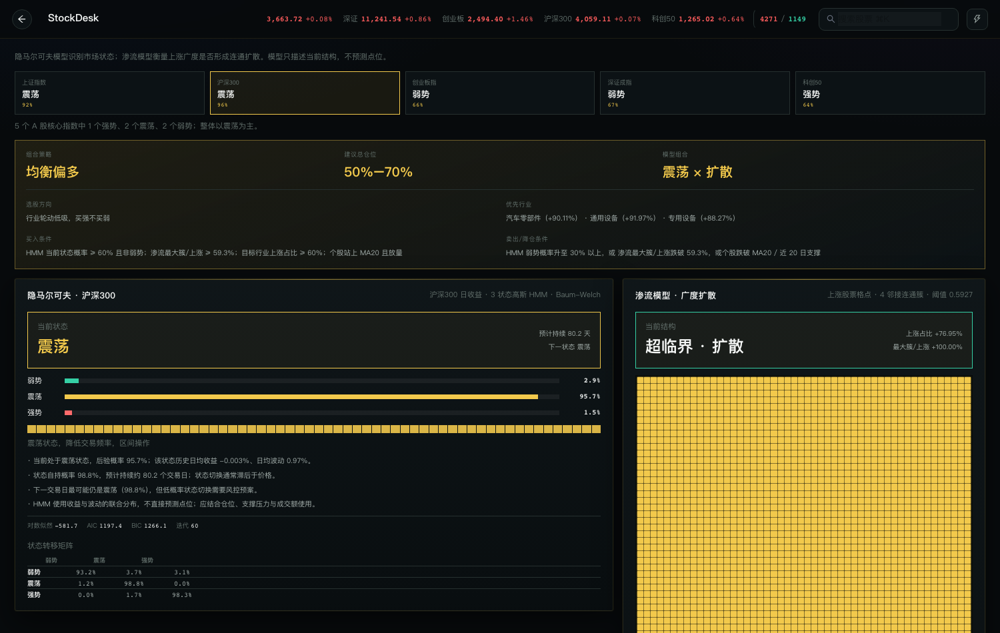

| 明亮 HUB | 深色 HUB |
| --- | --- |
| 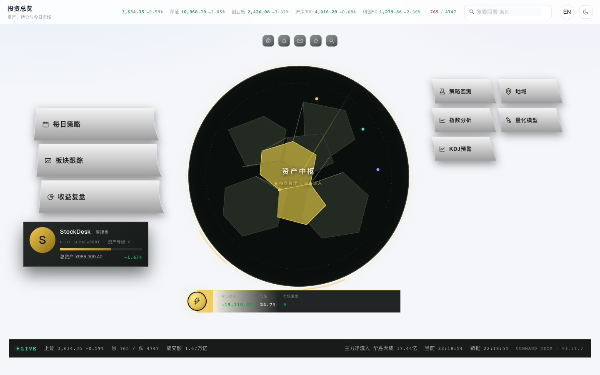 | 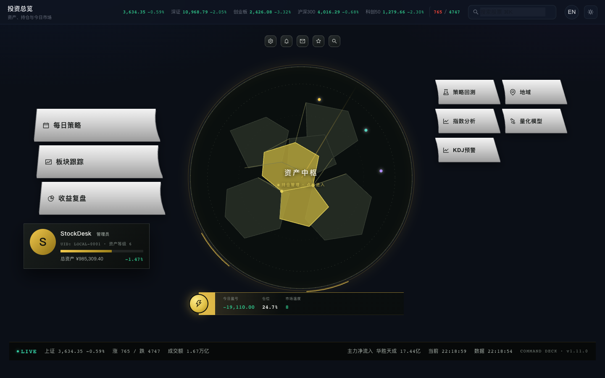 |

---

## 快速开始

### 方式一：双击 App（推荐，macOS）

```bash
open StockDesk.app
```

已打包好的 `StockDesk.app` 可直接双击启动，首次打开会创建本地数据库。
打包版把数据保存在 `~/Library/Application Support/StockDesk/`，与源码运行互不影响。

想先看看带演示持仓的界面：

```bash
.venv/bin/python scripts/seed_demo.py --reset
```

### 方式二：源码运行（推荐先灌入演示数据）

```bash
# 1. 准备 Python 环境（3.10+）
python3 -m venv .venv
.venv/bin/pip install -r requirements.txt

# 2. 构建前端（首次或前端改动后）
cd frontend && npm install && npm run build && cd ..

# 3. 启动（原生窗口，需要 pywebview）
.venv/bin/python main.py

# 或者只跑服务、用浏览器访问 http://127.0.0.1:8765
.venv/bin/python main.py --headless
```

常用参数：

| 参数 | 说明 |
| --- | --- |
| `--port 8765` | 指定端口（默认自动挑选空闲端口） |
| `--headless` | 只启动 API + 前端静态服务 |
| `--browser` | 用系统默认浏览器打开 |
| `STOCKDESK_DATA=/path` | 自定义数据目录（默认 `./data`，打包版为 `~/Library/Application Support/StockDesk`） |

### 重新打包桌面 App

```bash
./build_app.sh
```

> 打包依赖 PyInstaller。若 macOS 提示 Xcode license，可加
> `DEVELOPER_DIR=/Library/Developer/CommandLineTools` 再执行打包。

---

## 界面

- 默认 **白色背景 / 亮色主题**，右上角 ☾ 一键切换深色，选择会记住。
- A 股配色习惯：**红涨绿跌**。
- 图表（K 线、净值、回撤、资金曲线）随主题自动换色。

## v1.9 更新

- **HUB 精简为 7 个入口**：左侧 3 个（每日策略、板块跟踪、收益复盘），右侧 4 个（策略回测、地域、行业要闻、量化模型）
- **白色按键放大**：左侧按钮 300×78，右侧模块加高；按键随文字自动增高，不裁切
- **左列整体下移**：每日策略与右侧第二行严格对齐；管理员名片并入左列下方，不再固定屏幕底部
- **资产中枢**：中央圆形地图、旋转轨道、脉冲光环、扫描线与「运行中」动态效果；点击进入持仓
- **字体缩放**：设置内提供 100% / 120% / 150%，只放大文字，地图和固定图形不拉伸；卡片/表格自动换行、增行，避免遮挡
- **中英双语**：顶栏 EN / 中切换，设置内也可选择；语言本地保存
- **底部状态条**：LIVE、指数、成交额、当前时间与数据更新时间；150% 时改为流式布局，不覆盖管理员名片
- **图片分享**：HUB 不显示分享；进入子页面后分享当前完整页面为 PNG，可发送到微信 / Notes
- **主题**：指挥舱 HUD / 明亮 / 深色三种背景共用同一套 HUB 首页；切换只改变背景、顶栏与边框配色，不再切换到旧的侧栏首页
- **HUB 导航**：隐藏侧边栏，页面左上角返回；宽屏三栏、窄屏自动收敛
- **资产中枢地图**：中国上市公司分布，支持缩放/拖拽；省份龙头可折叠
- **量化模型**：A 股 5 指数 HMM + 渗流最大连通簇；HMM 决定总仓位，渗流决定行业与标的；含行业临界、关键标的、随机重排稳健性和个股仓位建议
- **稳定性**：资产快照本地缓存，启动不短暂归零；账户数据仅保存在本地 SQLite
- **管理**：管理员名称/UID 可在设置修改；资产等级按可用现金位数计算

## v1.3 更新

- **账户模型**：只维护「初始资产」作为收益基准；**总资产 = 可用现金 + 持仓市值**，随行情实时变化，可用现金按买卖流水自动推导
- **持仓账簿**：资金流水、盈亏结构、仓位结构、今日盈亏、累计盈亏、持有天数；交易流水支持筛选/搜索与逐笔 FIFO 已实现盈亏
- **收益复盘**：新增仓位/现金曲线、平均仓位、最大连胜/连亏、月度收益金额、平均持有天数、平仓明细（买卖价、持有天数）
- **回测策略**：由 5 种扩展到 10 种（新增唐奇安+ATR、均线+RSI、布林突破、KDJ、量价突破），标的支持名称/代码搜索
- **个股详情**：筹码分布、黄金分割 7 个位置的价格 + 操作参考、行业/概念标签、17 项公司概况、估值与交易指标解释
- **复盘总结**：根据收益、回撤、胜率、个股贡献、仓位与市场状态自动生成文字复盘与操作建议，并同时对比**沪深300**与**上证指数**
- **趋势分析**：净值 vs 20/60 日均线、当前回撤、当前仓位、基准 20 日表现
- **行情判断**：市场温度评分（0–100）、强势/偏强/震荡/偏弱/弱势结论与判断依据
- **市场情况**：涨跌分布、涨停/跌停、成交额、领涨行业、领涨概念、主要指数趋势（多头/空头 + RSI）
- **每日策略页**：每日行情、热点榜、主力追踪、行情分析、仓位管理推荐、今日标的推荐、明日支撑压力
- **行情分析**：指数 7/20/30/60 日表现、MA5/10/20/60、RSI、MACD、九转、底部钝化、20 日支撑/压力
- **行业趋势**：资金流入前列行业的 5/20/60 日表现与均线趋势
- **行情要闻**：东方财富 7×24 快讯 + 推荐关注；新增指标说明与分析逻辑
- **热点榜/主力追踪**：涨跌前 10、个股/行业主力净流入流出（顺序已互换，主力在前）
- **总览页**：新增热点榜（涨/跌前 10）
- **复盘页**：新增仓位管理推荐（目标仓位区间/单票上限/现金下限/加减仓动作）
- **板块跟踪页**：原「智能选股」升级为板块跟踪 + 市场情绪 + 个股热图 + 形态选股
- **K 线增强**：MACD 副图、九转序列（TD Sequential）标记，均可在 K 线卡片开关
- **持仓支撑压力**：每只持仓增加最近支撑/压力位（筹码密集区 + 黄金分割），并显示距现价百分比
- **移除**：价格提醒（导航、接口、后台监控全部删除）

## 功能

### 1. 投资总览
- 总资产、持仓市值、可用现金、今日盈亏、浮动 / 已实现盈亏、交易胜率
- 账户净值迷你曲线 + 与沪深 300 对比
- 持仓权重分布、今日涨幅榜、主力资金净流入榜
- 最近交易与自选股一览

### 2. 自选行情
- 自选股实时价格、涨跌幅、成交额、PE / PB
- 近 20 日 / 近 60 日走势迷你图
- 一键添加 / 移除，45 秒自动刷新

### 3. 个股详情
- 实时报价（开高低收、成交额、换手率、量比、市值、PE/PB）
- K 线图：日 / 周 / 月，前复权 / 后复权 / 不复权，MA5/10/20/60 + 成交量 + 缩放
- 行业与概念标签（东财核心题材）
- 筹码分布（平均成本、获利比例、90% 成本区间、集中度、支撑/压力）+ **筹码分析**（筹码偏多/中性/偏空评分、获利盘/套牢盘、成本偏离、筹码峰、60 日筹码迁移、支撑压力距离与逐条解读）
- 黄金分割位（0.236/0.382/0.5/0.618/0.786 价格、距现价、支撑/压力属性与操作参考），并直接叠加在 K 线图上，可用「黄金分割」开关显示/隐藏
- 完整公司概况（董事长、董秘、法人、信用代码、地址、网址、邮箱、电话、主营、经营范围、简介）
- 估值与交易指标带解释（PE/PB/ROE/换手率/量比/振幅等）
- 近 8 个报告期财务指标（EPS、BPS、ROE、营收/净利同比、毛利率、净利率、资产负债率）
- 直接「记一笔交易」或进入「策略回测」

### 4. 持仓账簿
- 买卖流水增删改，记录手续费与备注
- **初始资产**仅作为收益基准；总资产由「可用现金 + 持仓市值」实时计算，行情刷新即变化
- 移动平均成本法计算成本、浮动/已实现/累计盈亏、仓位权重、持有天数、今日盈亏
- 资金流水汇总（累计买入/卖出/净投入/费用），交易流水支持筛选、搜索与逐笔 FIFO 已实现盈亏
- 卖出数量超过持仓时会被阻止

### 5. 收益复盘
- 净值曲线（含沪深 300 基准）、回撤曲线
- 累计 / 年化收益、最大回撤、波动率、夏普、卡玛、Beta、Alpha、平均仓位、最大连胜/连亏
- 仓位与现金占比曲线、月度收益金额、平均持有天数
- 月度收益热力图（按年汇总）
- FIFO 平仓配对：胜率、盈亏比、平均盈亏、最大单笔盈亏
- 个股已实现盈亏贡献排行与近期平仓明细

### 6. 策略回测
内置 5 种可调参数策略：

| 策略 | 逻辑 |
| --- | --- |
| 双均线交叉 | 短均线上穿长均线买入，下穿卖出 |
| 动量突破 | 突破 N 日最高价买入，跌破 M 日最低价卖出 |
| RSI 超卖反转 | RSI 低于阈值买入，高于阈值卖出 |
| MACD 金叉 | DIF 上穿 DEA 且零轴上方买入，下穿卖出 |
| 布林带回归 | 跌破下轨买入，回到中轨 / 上轨卖出 |
| 唐奇安通道 + ATR 止损 | 突破 N 日高点入场，跌破 M 日低点或回撤 ATR 倍数离场 |
| 均线 + RSI 过滤 | 均线金叉且 RSI 未过热时买入，死叉卖出 |
| 布林带突破 | 突破上轨买入，跌破中轨卖出 |
| KDJ 金叉 | K 上穿 D 低位买入，下穿或超买卖出 |
| 量价突破 | 突破 N 日新高且放量买入，跌破均线卖出 |

回测引擎特点：
- **次日开盘成交**，避免用当日收盘价"偷看未来"
- 手续费（万 2.5，最低 5 元）、卖出印花税（千 0.5）、滑点（0.05%）全部计入
- 资金不足 1 手时支持零股买入（便于高价股 / 小资金）
- 输出资金曲线、买入持有对比、回撤曲线、完整交易明细与绩效指标

### 7. 每日策略
- **每日行情**：指数涨跌、涨跌家数、涨停/跌停、成交额、领涨/靠后行业、领涨概念、市场温度与一句话复盘
- **热点榜**：全市场涨幅/跌幅最多的 10 只股票
- **主力追踪**：个股/行业主力净流入、净流出，实时行业推荐
- **行情分析**：五大指数 MA5/10/20/60、RSI、MACD、20 日支撑/压力
- **仓位管理推荐**：按市场温度、账户回撤、持仓集中度给出目标仓位区间、单票上限、现金下限、加减仓动作与风险提示
- **今日标的**：形态 + 量价 + 流动性综合评分，给出触发信号与理由，自动过滤 ST、涨停追高与短期涨幅过大
- **明日关注**：上证指数 / 沪深300 的最近支撑、压力、MA20/MA60

### 8. 板块跟踪 / 市场情绪 / 个股热图
- **板块跟踪**：行业与概念板块列表，涨跌幅、主力净流入、上涨/下跌家数、领涨股；点击查看成分股
- **市场情绪**：市场温度评分、涨跌分布、涨停/跌停家数、成交额、涨停池、今日强势股、指数趋势（20/60 日线 + RSI）
- **个股热图**：按行业分组的全市场 treemap，面积=市值、颜色=涨跌幅，点击个股进入详情
- **形态选股**：均线多头、MACD 金叉、放量突破、缩量回踩、双底、平台突破、九转买卖 9、RSI 超卖反弹、布林下轨反弹，扫描成交额/市值前 N 只

---

## 数据与隐私

- 行情、K 线、财务数据来自**东方财富公开接口**（akshare 同源数据，本项目直接走轻量 HTTP，避免分页抓取过慢），仅用于个人研究，可能有延迟。
- 账户、交易、自选只写入本机 SQLite：`data/stockdesk.db`，缓存：`data/cache.db`。
- 无账号体系、无云端同步、无任何数据上传。
- 所有金额单位为人民币元，涨跌颜色遵循 A 股习惯：**红涨绿跌**。

## 技术栈

- 后端：FastAPI + Uvicorn + SQLite + 标准库 HTTP（直接访问东财接口，无重量级行情 SDK）
- 主题：CSS 变量 + Ant Design 5 主题令牌 + ECharts 主题色，亮色为默认
- 前端：React 18 + TypeScript + Vite + Ant Design 5 + ECharts 5
- 桌面壳：pywebview（macOS WKWebView）
- 打包：PyInstaller（bundle 前端静态资源）

## 目录结构

```
stockdesk/
├── scripts/seed_demo.py # 演示数据 / 一键重置
├── backend/
│   ├── technical.py    # 筹码分布 / 黄金分割
│   ├── api.py          # REST + WebSocket 路由
│   ├── app.py          # FastAPI 入口 + SPA 静态服务
│   ├── market.py       # 行情 / K线 / 财务 / 指数 数据客户端
│   ├── portfolio.py    # 持仓成本、盈亏、净值、FIFO 统计
│   ├── backtest.py     # 回测引擎与策略
│   ├── screener.py     # 选股
│   ├── clock.py        # A 股交易时段
│   ├── repo.py         # 自选 / 账户仓储
│   ├── db.py           # SQLite 与 KV 缓存
│   └── config.py       # 路径与常量
├── frontend/           # React + Vite 前端
├── main.py             # 桌面启动器（API + pywebview）
├── build_app.sh        # 一键打包 macOS App
├── stockdesk.spec      # PyInstaller 配置
└── data/               # 本地数据库（运行后生成）
```

## HTTP API

服务启动后可在 `http://127.0.0.1:<port>/api/docs` 查看交互式文档（Swagger）。

主要接口：

- `GET  /api/market/overview` 指数 + 涨跌家数 + 交易时段
- `GET  /api/market/kline/{code}?period=daily&limit=320` K 线
- `GET  /api/market/stock/{code}` 个股详情（行情 + 概况 + 财务）
- `GET  /api/market/search?q=茅台` 股票搜索
- `GET  /api/portfolio/summary` 账户汇总与持仓
- `POST /api/portfolio/trades` 记录交易
- `GET  /api/portfolio/analytics` 净值 / 回撤 / 交易统计
- `POST /api/backtest/run` 运行回测
- `POST /api/screener` 选股
- `GET  /api/market/technical/{code}` 筹码分布 + 黄金分割

## 已知限制

- 仅覆盖 A 股；港股 / 美股 / 基金 / 债券暂未支持。
- 行情为公开接口快照，非逐笔实时；交易决策请以券商行情为准。
- 回测为单标的、全仓进出模型，不处理停牌、涨跌停无法成交、分红再投资等极端情况。
- 除权除息日前复权可能出现负价格，此时自动回退为不复权展示。

## License

个人使用项目，仅供学习与研究，不构成任何投资建议。


---


## English

### Overview

StockDesk is a local-first, single-user equity research desk. Market data comes from Eastmoney public endpoints; trades, holdings and settings stay in a local SQLite database.

The default surface is the **HUB**: a dark circular asset hub, three enlarged silver action buttons on the left, four modules on the right, an admin plate under the left column, and a LIVE status bar. HUD, light and dark themes share the same HUB home; the theme switch only changes background, top bar and border colors.

### Highlights

- Left 3 actions: Daily Plan, Sectors, Review
- Right 4 modules: Backtest, Regions, Industry News, Quant Models
- Click the central disc to open the portfolio
- Font scaling 100% / 120% / 150%: text only, with automatic wrapping and row growth
- Built-in Chinese / English switch in the top bar and Settings
- Full-page image sharing from detail pages
- HMM on five A-share indices + percolation giant component; per-stock position guidance

### Screens

| Portfolio | Chips | Review |
| --- | --- | --- |
|  |  |  |

| Sectors | Mood | Heatmap |
| --- | --- | --- |
|  |  |  |

| Patterns | Candles + MACD | Daily Plan |
| --- | --- | --- |
|  |  |  |


### Run

```bash
python3 -m venv .venv
.venv/bin/pip install -r requirements.txt
cd frontend && npm install && npm run build && cd ..
.venv/bin/python main.py
```

Data: `~/Library/Application Support/StockDesk` on macOS, `%LOCALAPPDATA%\StockDesk` on Windows.

