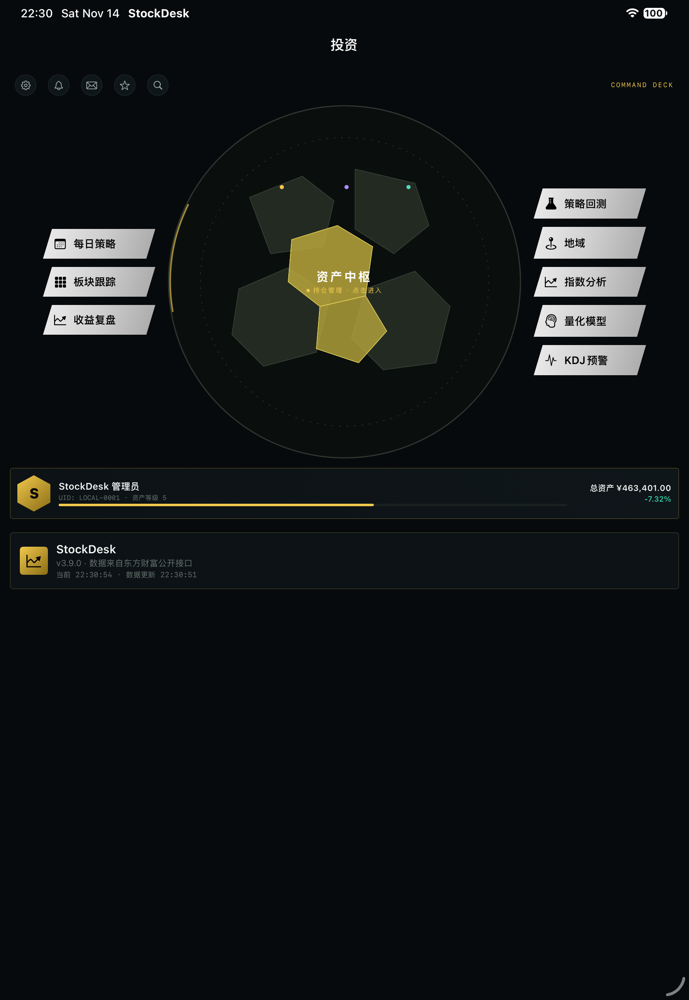
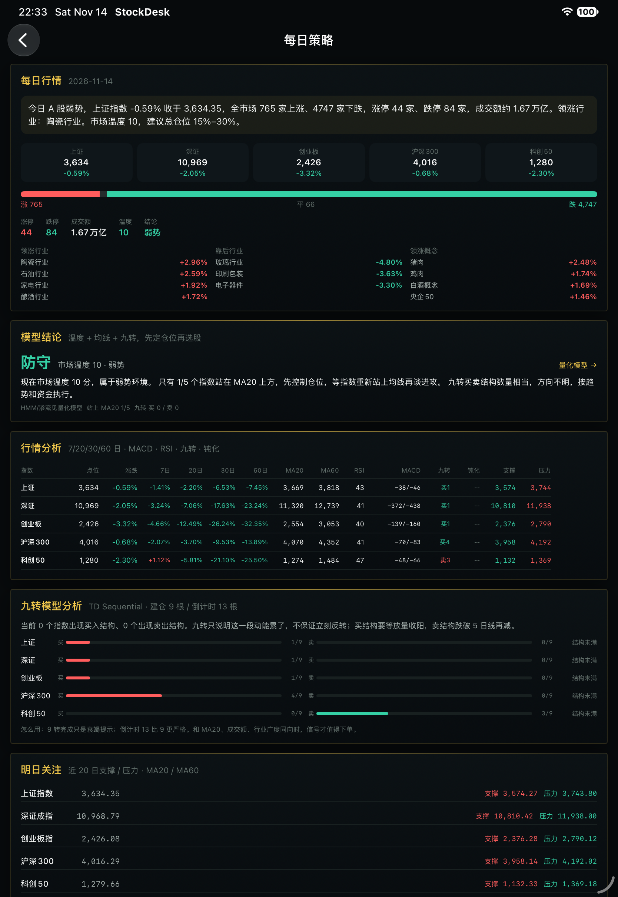

# 使用指南与流程 · Guide & Workflow

[中文](#中文) · [English](#english) · [下载页](https://cxy2696.github.io/stockdesk-akshare/#download) · [Releases](https://github.com/cxy2696/stockdesk-akshare/releases)

> 适用版本：macOS / Windows **1.12.0** · iOS **3.9.0 (32)** · 美股 **1.0.2**
>
> 第一次用只看第 1、2 节。后面的页面说明当字典查，不用一次读完。

## 中文

### 1. 选择版本与安装

| 平台 | 推荐文件 | 大小 | 安装 |
| --- | --- | --- | --- |
| macOS 12+ Apple Silicon | `StockDesk-macOS-1.12.0.dmg` | 43 MB | 打开 DMG，双击 `Install-StockDesk.command` |
| macOS 12+ Apple Silicon | `StockDesk-macOS-1.12.0.zip` | 41 MB | 解压后双击 `Install-StockDesk.command` |
| Windows 10/11 x64 | `StockDesk.exe` | 52 MB | 双击；需要 WebView2 |
| iPhone / iPad iOS 17+ | `StockDesk-iOS-3.9.0-unsigned.ipa` | 1.9 MB | Sideloadly / AltStore / Xcode 重签 |
| 浏览器 / NAS | GHCR 容器 | — | 见 [PACKAGES](PACKAGES.md) |

> 安装包与源码版本一致，均为 1.12.0 / iOS 3.9.0；需要自行构建时用 `cd desktop && ./build_app.sh`（macOS）或 `build_win.ps1`（Windows），iOS 用 `xcodegen generate` 后从 Xcode 打包。

#### macOS 首次打开

App 是 ad-hoc 签名，浏览器下载后会带 `com.apple.quarantine`，Gatekeeper 可能提示「无法打开 / 已损坏」。安装包里的 `Install-StockDesk.command` 会自动复制到 Applications、清除标记并启动；脚本被拦截时右键 → 打开。

手动兜底：

```bash
xattr -dr com.apple.quarantine /Applications/StockDesk.app
open /Applications/StockDesk.app
```

DMG 里的 App **不要直接双击运行**；先运行安装脚本或拖进 Applications。macOS 包仅 Apple Silicon，Intel Mac 请从源码运行或使用容器。

#### Windows 首次打开

- SmartScreen 提示「已保护你的电脑」：点「更多信息」→「仍要运行」。
- 需要 WebView2 Runtime；没有时会退回默认浏览器。
- 双击后没有窗口：运行 `StockDesk.exe --browser`，并查看 `%LOCALAPPDATA%\StockDesk\stockdesk.log`。

#### iOS 安装

IPA 未签名，必须用 Apple ID 重签（Sideloadly / AltStore / Xcode）。免费签名 7 天有效；App 完全本地运行，不需要 Mac 后端。

#### Docker

```bash
docker run --rm -p 8765:8765 -v stockdesk-data:/data ghcr.io/cxy2696/stockdesk-akshare-a-share:latest
docker run --rm -p 8770:8770 ghcr.io/cxy2696/stockdesk-akshare-us:1.0.2
```

镜像标签跟发布构建走：A 股示例用 `latest`，美股 `1.0.2`；需要固定版本时把标签换成对应的已发布版本。

### 2. 第一次打开：五分钟


1. **HUB**：中央圆盘是资产中枢，**点一下直接进持仓管理**。左列每日策略、板块跟踪、收益复盘；右列策略回测、地域、指数分析、量化模型、KDJ 预警；顶部是设置、异常提醒、笔记、自选、搜索。
2. **设置账户**：齿轮 → 初始资产、管理员名称、UID。初始资产只是收益基准。
3. **记一笔交易**：点中央圆盘进持仓管理 → 记一笔交易（代码 / 方向 / 价格 / 数量 / 日期）。
4. **加自选**：点顶部星号，搜索代码或名称。
5. **看每日策略**：先读页面顶部的摘要和模型结论，再看今日标的。
6. **看模型与 KDJ**：模型页看 HMM 状态和渗流最大簇；KDJ 看 5m / 30m 有没有进极值区。
7. **忘了怎么用**：左侧栏 → 使用指南。9 章分别是 5 分钟上手、每日使用流程、页面地图、指标词典、仓位与风控、数据与隐私、快捷键与效率、常见问题、版本与更新。

刚打开时总资产等于初始资产、可用现金等于本金、仓位 0，这是正常的。首次拉全市场快照要几秒。

### 3. 页面地图

| 页面 | 路径 | 看什么 | 常用动作 |
| --- | --- | --- | --- |
| HUB / 总览 | `/` | 总资产、今日盈亏、仓位、市场温度、LIVE | 点圆盘进持仓管理；左右两列进各模块 |
| 每日策略 | `/daily` | 每日行情、模型结论、主力追踪、行情分析、九转、行业关注、要闻 | 盘前定攻守；标的点进详情，要闻点原文 |
| 自选行情 | `/watchlist` | 实时价、涨跌幅、20/60 日走势 | 搜索添加；点行进个股 |
| 个股详情 | `/stock/:code` | K 线、MACD、九转、筹码、黄金分割、财务 | 记一笔交易；对照支撑压力 |
| 持仓管理 | `/portfolio` | 持仓总览 / 资产分析 / 投资建议 / 交易流水 四个 Tab | 记账、改账、看超限提醒 |
| 收益复盘 | `/analytics` | 净值、回撤、仓位、月度收益、FIFO 统计 | 每周或每月看一次 |
| 策略回测 | `/backtest` | 10 套策略、资金曲线、交易明细 | 一次只改一个参数 |
| 板块跟踪 | `/screener` | 板块、市场情绪、个股热图、形态选股 | 切行业/概念；热图下钻进个股 |
| 地域 | `/regions` | 34 个省级行政区的公司数、涨跌、资金、龙头 | 切省份；地图点击联动 |
| 指数分析 | `/index-analysis` | 12 个 A 股宽基 + 3 个海外指数、支撑压力、结论 | 看综合评分和偏多/偏空数量 |
| 量化模型 | `/models` | HMM、渗流、九转、综合评分、行业关注、个股仓位建议 | 先看综合评分和结论条，再看拆解 |
| KDJ 预警 | `/kdj` | 5m / 30m 的 K/D/J、RSV、量比、中枢 | 看极值方向和持续性 |
| 设置 | `/settings` | 资产、主题、缩放、语言、缓存、数据目录 | 备份前先退出 App |
| 使用指南 | `/guide` | 5 分钟上手到版本更新，9 章 | 侧栏目录跳转；页内可点进各页面 |

旧地址不用改：`/asset-analysis` 自动跳到持仓管理的资产分析 Tab，`/advice-center` 跳到投资建议 Tab，`/industry-news` 和 `/index-analysis` 都指向指数分析。

#### 3.1 个股详情


日 / 周 / 月 K、MA、成交量、MACD、九转、筹码分布、黄金分割、支撑压力、公司概况和财务指标。筹码图看平均成本、获利比例、90% 成本区间、集中度和支撑/压力；黄金分割位可以直接叠在 K 线上开关。

### 4. 每日策略


一页从上到下，顺序就是阅读顺序。

- **每日行情**：五个指数点位与涨跌、涨跌家数、涨停/跌停、两市成交额、领涨与靠后行业、领涨概念、市场温度和一句话结论。
- **模型结论条**：HMM 状态 × 渗流结构给出策略和总仓位——进攻 60%–80%、均衡偏多 45%–65%、均衡偏防守 25%–45%、防守 0%–20%。点一下跳到下面的拆解。
- **主力追踪**：三列——个股净流入前 6、个股净流出前 6、行业净流入前 6；顶部是主力净流入、净流出和资金榜净额。颜色跟方向走，负值不会再标红；空值也不会混进流出榜。
- **热点榜**：全市场涨幅和跌幅最大的 10 只股票，点行进个股详情。
- **行情分析**：指数 7 / 20 / 30 / 60 日涨跌、MA20 / MA60、RSI、MACD、九转、支撑压力；上方三个小结卡片是 HMM、渗流、九转。
- **九转模型**：5 个指数的九转结构、买卖进度（x/9）、倒计时（x/13），持仓个股与临界行业龙头的九转状态，最后是使用说明。
- **多周期表现与行业趋势**：五大指数的 5 / 20 / 60 日平均涨跌，以及资金流入前列行业的多周期表现。
- **行业关注重点**：行业广度、最大连通簇、主力资金、龙头和一句关注要点。行业字段缺失时按市场分组，页面会标注。
- **行业要闻**：东方财富 7×24 快讯与要闻合并，支持「全部 / 行业相关 / 快讯 / 要闻」筛选和展开更多；**点标题直接打开东方财富全文**。右侧两块是「今天盯这几个方向」和「行业关注」。
- **仓位管理推荐、明日关注、今日标的、指标说明**：仓位区间与加减仓动作、指数的明日支撑压力、候选标的评分与理由、每个数字的定义。

标的列表是研究候选，不是买入指令。

### 5. 持仓管理（原持仓账簿 + 资产分析 + 投资建议）


顶部四个 Tab：

| Tab | 内容 |
| --- | --- |
| 持仓总览 | 总资产、可用现金、持仓市值、浮动/已实现盈亏、单票权重、成本、持有天数、支撑压力 |
| 资产分析 | 资金分配、持仓集中度、交易偏好、趋势与交易习惯 |
| 投资建议 | 历史总结、未来趋势、仓位建议、标的推荐 |
| 交易流水 | 买卖流水增删改、筛选、逐笔 FIFO 已实现盈亏 |

初始资产在右上角，也可以用设置里的入口。总资产 = 可用现金 + 持仓市值，随行情变动；改初始资产会重算现金和收益基准，交易流水不变。

### 6. 指数分析

一屏看 12 个 A 股宽基（上证、深证、创业板、科创50、沪深300、上证50、中证500、中证1000、北证50、中证A500、国证2000、红利指数）和 3 个海外指数（标普500、纳斯达克、道琼斯）。

每张卡有 1 / 5 / 20 / 60 / 120 日涨跌、MA20 / 60 / 120 与现价的距离、RSI、MACD 柱、20 日波动、支撑压力、52 周高低，右上角是偏多/中性/偏空和评分。页面顶部给 A 股的综合结论和平均评分；海外指数只做隔夜参考。

### 7. 量化模型

模型注册表 2.2.0：HMM 2.1.0（过滤后状态、状态质量/区分度、风险分、建议暴露）、渗流 2.1.0（12 次 bootstrap 区间、稳定性、广度趋势）、九转 1.1.0（质量、新鲜度、完成度）。顶部「综合评分」把三者按 HMM 42% / 渗流 38% / 九转 20% 合成 0–100 分，并显示分项、一致度和依据；分项不足时按中性 50 分计入，不会因为缺数据把分数拉爆。


模型注册表 **2.2.0**，四个模型各管一段：

- **HMM 2.0.0**：3 状态高斯隐马尔可夫，输入 5 个核心指数的日对数收益（上证、沪深300、创业板、深证、科创50）。多起点 Baum-Welch（3 个初始化，取似然最优），状态按均值排序为弱势 / 震荡 / 强势。输出后验置信度、熵、已持续天数、平均持续天数、离开概率，以及每个状态的日均收益、年化波动、夏普和胜率。
- **渗流 2.0.0**：全市场约 5,500 只股票按稳定哈希排进二维方格，避免按代码成块；4 邻接找最大连通簇，阈值 0.592746。输出最大簇占比、簇数量、是否跨越整张格点、susceptibility、随机重排基线与 p 值，以及 50×50 分块图。行业字段缺失时按市场分组。
- **九转 TD 1.0.0**：DeMark TD Sequential。建仓结构 9 根（收盘价对比 4 日前），倒计时 13 根（对比 2 日前高/低）。输出买卖计数、倒计时、信号、偏多/偏空、评分和一句中文解读。
- **KDJ 1.2.0**：5m / 30m 的 KDJ(9,3,3)，上轨 118、下轨 -14，180 根。

三个模型的配合写在模型页最下面的「策略映射」：HMM 定总仓位，渗流定行业和扩散，九转定买卖时点。九转是**动能衰竭提示，不是反转保证**。

首次算模型要等十几秒到半分钟。东方财富失败时会打开 45 秒短熔断，期间直接走新浪；全市场快照、板块列表和资金流各有单飞锁，同一个请求不会重复下载。网络受限时每日策略仍能在数十秒内返回。

### 8. 收益复盘、地域与热图

#### 8.1 收益复盘

- **趋势分析**：净值、MA20（青色实线）、MA60（紫色虚线）用三种颜色区分；只有 1 个交易日时只画数据点，并提示「第二个交易日后展开」。
- **净值曲线**：账户用主题色实线加面积，沪深300 用蓝色虚线。基准缺失时隐藏这条线并在图例标注；tooltip 同时给账户、基准和超额。
- **仓位与现金、回撤、月度热力图、FIFO 统计**保持原样；首日或单点数据不再白屏。

#### 8.2 地域

覆盖 34 个省级行政区：23 个省、5 个自治区、4 个直辖市、2 个特别行政区。

下拉搜索、上一省 / 下一省按钮、地图点击联动、全部省份列表都可以切换。每个省份显示上市公司数、涨跌家数、地域涨跌、主力净流入、代表行业和领涨公司；接口没返回时写「数据源暂未返回」，不空白。iOS 用同一套省份数据。

#### 8.3 个股热图


按行业/板块分组，面积 = 总市值，颜色 = 涨跌幅。单击板块下钻，面包屑返回，单击个股进详情，悬停高亮。上方能搜索代码/名称、只看上涨、只看下跌、重置，并统计上涨/下跌家数和平均涨跌。

面积过小的方块会被隐藏（`visibleMin`），几千个 2–3px 的小块不再糊成噪点；小市值个股用搜索能找到。

### 9. KDJ 预警


- 上轨 `J ≥ 118` 超买，下轨 `J ≤ -14` 超卖；5 分钟偏即时，30 分钟偏质量。
- 11 个标的：半导体、通信设备 + 9 个 A 股指数。
- 指标：K/D/J、RSV、MA5/20、量比、中枢位置、J 变化、拐头、趋势。
- 行业板块分钟线不可达时用并标注 ETF 代理（半导体 512480、通信设备 515880）；指数走新浪分钟线。
- 每 60 秒刷新；触发时显示深琥珀色提醒横幅。

### 10. iOS / iPad 版




完全独立的 SwiftUI App，当前 **3.9.0 (32)**，支持 iPhone 与 iPad：HUB 3+5 模块、搜索/自选/笔记/异常提醒、100%/120%/150%、横竖屏、本地 `stockdesk.json`。iPad 会自动放大 HUB、四列 KPI、双列 KDJ 图表和地图；150% 自动单列 HUB。

本轮变化：

- HUB 中央圆盘直接进持仓管理，右侧第三个入口从「行业要闻」改为「指数分析」。
- 每日策略的主力追踪改成三列（个股流入 / 个股流出 / 行业流入），新增「模型结论」卡和「九转模型分析」卡。
- 持仓管理顶部加了「资产分析 / 投资建议」两个快捷入口。
- 要闻标题可点开东方财富全文，并显示摘要。




KDJ 行业卡在东方财富不可达时回退到 ETF 代理并标注；指数走新浪；北证 50 使用 `bj899050`；无数据显示「暂无」而不是「正常」。


行业/概念板块回退新浪资金流；成分股仍需东方财富 BK 代码。

### 11. 美股版


```bash
cd us && python -m venv .venv && source .venv/bin/activate
pip install -r requirements.txt && python run.py --port 8770
```

打开 <http://127.0.0.1:8770>：指数、自选、搜索、日 K、榜单、市场宽度；页面和 ECharts 本地加载。美股版版本仍是 1.0.2。

### 12. 每天的使用顺序

```
盘前 08:50–09:00
  HUB 看指数、涨跌家数、成交额 → 每日策略读模型结论和九转
  → 持仓管理看仓位、止损和超限提醒

盘中 09:30–15:00
  自选、个股详情找执行点；成交后立刻补录价格、数量、费用

盘后 15:00 以后
  补录当天交易 → 收益复盘（每周或每月看一次）
```

盘前定攻守，盘中只执行和记录，盘后复盘。不要每天重做一遍总仓位；一周调整 1–2 次已经够多。

### 13. 指标词典

| 指标 | 先看什么 | 一句话 |
| --- | --- | --- |
| MA 均线 | 价格与 MA20 的位置、MA20 斜率 | 站上且多头排列偏强，跌破 MA20 / 60 转弱 |
| RSI(14) | 70 / 30 的位置、有没有背离 | 超买能更超买，超卖能更超卖 |
| MACD | 零轴位置、金叉死叉、柱体 | 零轴上方金叉更可信 |
| 九转 | 9/9 与 13/13、完成后 20 根 | 衰竭不等于反转 |
| 底部钝化 | 60 日低位、RSI 35 下方拐头 | 左侧信号，先等止跌 |
| 主力净流入 | 连续 3–5 日、占成交额比例 | 单日大单会骗人 |
| 筹码分布 | 获利比例、90% 区间、集中度 | 是估算，不是真实持仓 |
| 黄金分割 | 0.382 / 0.5 / 0.618 与前高、MA 重合 | 高低点选错就全错 |
| KDJ | J ≥ 118 / J ≤ −14、5m 与 30m 同向 | 强趋势会钝化 |
| 市场温度 | 0–100 的分值与连续方向 | 不是仓位公式 |
| HMM | 状态概率、已持续天数 | 拐点处滞后 |
| 渗流 | 最大簇 / 上涨，对比 59.27% | 格点不是产业关系 |
| 行业广度 | 上涨占比 ≥ 60%、最大簇不收缩 | 小样本行业会失真 |

#### 13.1 HMM 三状态

对 5 个核心指数的日对数收益拟合 3 状态高斯 HMM。三个状态按均值从低到高排成弱势、震荡、强势，含义是「最近的收益和波动更像哪一种」。

怎么读：

- 状态概率 ≥ 60% 才算方向明确；熵越低越确定。
- 「已持续」是这一状态连续的天数，跟历史平均持续天数比，能看出这轮是刚开始还是接近尾声。
- 「明日离开概率」= 1 − 自持概率。数值高时，仓位别压在单一方向上。
- 每个状态的日均收益、年化波动、夏普、胜率是样本内统计，用来说明「这个状态历史上长什么样」。

边界：状态切换滞后于价格，拐点最容易错；3 个状态是拟合出来的，不是基本面判断。

#### 13.2 渗流最大连通簇

把全市场约 5,500 只股票按稳定哈希排进二维方格，上涨的格子记为占据，按 4 邻接找最大连通簇。最大簇 ÷ 上涨家数 = `giant_occupied`。

怎么读：

- ≥ 59.27%（二维方格点渗流临界值）：上涨连成片，扩散有基础。
- 在临界值下方 8 个百分点内：临界附近，方向未定。
- 更低：上涨彼此孤立，属于少数主线的结构性行情。

再看三个辅助量：`spanning`（最大簇有没有贯穿整张格点）、`susceptibility`（越大越接近临界）、`p 值`（随机重排后仍能达到实际最大簇的比例，越小说明真实行业结构贡献越大）。50×50 分块图里，深色块代表有最大簇成员。

边界：格子位置不代表产业关系；单日快照会抖；行业样本小时 59.27% 不能直接套。

#### 13.3 九转（TD Sequential）

- **建仓结构**：连续 9 根收盘价低于 4 日前收盘价 → 买入结构 9/9；高于 → 卖出结构 9/9。
- **倒计时**：结构完成后，最多 13 根。买入方向数跌破 2 日前低点的根数，卖出方向数突破 2 日前高点的根数，13/13 为完成。
- 输出：买卖计数、倒计时、信号（`buy_9` / `sell_9` / `buy_13` / `sell_13`）、偏多/偏空、评分和一句中文解读。

怎么读：

- 9/9 是这一段动能衰竭，不是反转确认；要等放量收阳、收复 5 日线或站回支撑。
- 7/9 只观察，不当作买点。
- 13/13 比 9/9 严格，出现时更需要成交量配合。
- 结构完成后 20 根内仍算有效；超过 20 根只当背景。

边界：下跌中 9 之后还能继续跌；震荡市计数反复清零；停牌、除权会打断计数。

### 14. 仓位与风控

| 项目 | 建议 | 怎么执行 |
| --- | --- | --- |
| 总仓位 | 模型结论条给的区间；每日策略的仓位推荐冲突时取更小的 | 单次调整不超过 10%，不在盘中临时改 |
| 单票上限 | 模型页按 15%，仓位推荐按温度给 15%–25% | 两处取更小的那个，超过先减 |
| 行业上限 | 单行业不超过 30% | 主题重叠的行业按一条产业链合并算 |
| 止损 | 建仓前写下来，不写不买 | 跌破近 20 日支撑或 MA20、收盘不收回，先减一半；再破全出 |
| 加仓 | 首仓 1/3，确认后 1/3，突破或回踩再加 1/3 | 每次加仓后把止损上移，不对亏损仓补仓 |
| 减仓 | 先减超限、破位、行业广度转弱的 | 分 2 批，反弹减，不追跌杀跌 |
| 现金 | 至少留 8%–10%，弱势留 20% 以上 | 现金是仓位的一部分 |

模型给的是区间和条件，不是指令。同样的 60% 仓位，对别人合适，对你未必。

### 15. 数据、备份与迁移

| 平台 | 数据目录 |
| --- | --- |
| macOS | `~/Library/Application Support/StockDesk` |
| Windows | `%LOCALAPPDATA%\StockDesk` |
| 源码运行 | `desktop/data/` |
| iOS | App 沙盒 |
| Docker | 挂载 `/data` |

退出 App 后复制整个目录备份；恢复时先退出再放回。`cache.db` 可以不复制，`stockdesk.db` 一定要。行情缓存可丢，账户、交易、自选、笔记和提醒最重要。

### 16. 设置、分享与缩放


设置含初始资产、名称 / UID、HUD / 亮色 / 深色、100% / 120% / 150%、中文 / English、缓存清理、数据目录；iOS 还有屏幕方向。缩放只放大文字，地图和图表不拉伸。子页面右下角分享按钮生成长图，HUB 首页不显示分享。

#### Ollama 本地辅助（仅 macOS / Windows）

1. 先安装 Ollama，执行 `ollama pull deepseek-r1:8b`，确认 `ollama serve` 在跑。
2. 设置 →「Ollama 本地辅助」：打开开关，地址填 `http://127.0.0.1:11434`，模型选 `deepseek-r1:8b`。
3. 点「测试连接」，看到「已连接 · 模型可用」后保存。
4. 回到每日策略或量化模型，点「生成判断」。首次约 20–60 秒，结果缓存 10 分钟；只读取缓存，不自动生成。
5. 未启用、连不上、模型缺失都只提示，不影响其他页面。默认关闭；iOS 不集成。

详细安装（含 Windows）、隐私边界与 FAQ：[Ollama 指南](OLLAMA.md)。

### 17. 常见问题

- **macOS 无法打开 / 已损坏**：运行 `Install-StockDesk.command`；或 `xattr -dr com.apple.quarantine /Applications/StockDesk.app`。仍被拦截到「隐私与安全性」点「仍要打开」。
- **macOS 空白页**：确认从 Applications 启动；查看 `~/Library/Application Support/StockDesk/stockdesk.log`。启动失败会弹原生错误提示。
- **Windows 没窗口**：装 WebView2；SmartScreen 选「更多信息 → 仍要运行」；或 `StockDesk.exe --browser`。
- **iOS 安装失败**：IPA 未签名，必须重签；免费签名 7 天过期。
- **端口被占用**：启动器会自动换端口，看日志里的实际地址。
- **页面还是旧版**：设置 → 数据与缓存里服务版本应为 1.12.0；强制刷新或退出重开。旧入口 `/asset-analysis`、`/advice-center`、`/industry-news` 会自动跳转。
- **加载慢或数字不动**：公开接口会限流。HUB 30 秒、自选 45 秒、KDJ 60 秒、每日策略 3 分钟、模型页 5 分钟自动刷新（后端缓存 10 分钟）；缓存没过期时返回同一份数据。
- **板块或 KDJ 数据不对**：东方财富不可达时回退新浪（行业代码 `SINA*`）或 ETF 代理，页面会标注。
- **清缓存**：设置 → 数据 → 清理行情缓存；不会删账户和交易。
- **换电脑怎么备份**：先退出 App 再复制整个数据目录；笔记和主题存在界面本地存储里，重要笔记先复制文本。

### 18. 源码与打包

```bash
git clone https://github.com/cxy2696/stockdesk-akshare.git
cd stockdesk-akshare/desktop
python -m venv .venv && source .venv/bin/activate
pip install -r requirements.txt
cd frontend && npm ci && npm run build && cd ..
python main.py            # --browser 仅浏览器
```

macOS 打包：`cd desktop && VERSION=1.12.0 ./package_macos.sh`<br>
Windows 打包：`cd desktop && powershell -ExecutionPolicy Bypass -File .\build_win.ps1`

完整依赖、iOS/容器构建与发版见 [INSTALL](INSTALL.md)。行情与模型用于研究，不构成投资建议。

## English

### Install

| Platform | File | Size | Install |
| --- | --- | --- | --- |
| macOS 12+ Apple Silicon | `StockDesk-macOS-1.12.0.dmg` | 43 MB | Open the DMG and run `Install-StockDesk.command` |
| macOS 12+ Apple Silicon | `StockDesk-macOS-1.12.0.zip` | 41 MB | Unzip and run `Install-StockDesk.command` |
| Windows 10/11 x64 | `StockDesk.exe` | 52 MB | Double-click; WebView2; SmartScreen → More info → Run anyway |
| iPhone / iPad iOS 17+ | `StockDesk-iOS-3.9.0-unsigned.ipa` | 1.9 MB | Re-sign with Sideloadly / AltStore / Xcode |

The macOS app is ad-hoc signed. The installer clears `com.apple.quarantine`; manual fallback:

```bash
xattr -dr com.apple.quarantine /Applications/StockDesk.app
open /Applications/StockDesk.app
```

The IPA is unsigned. The macOS build is Apple Silicon only; Intel Macs should run from source or use a container. Container tags: `stockdesk-akshare-a-share:latest` and `stockdesk-akshare-us:1.0.2`.

### First five minutes


1. Open HUB. The central disc opens Portfolio directly. Three actions on the left (Daily Plan, Sectors, Review), five modules on the right (Backtest, Regions, Index Analysis, Quant Models, KDJ). Top tools: Settings, Anomalies, Notes, Watchlist, Search.
2. Set initial capital, admin name and UID in Settings.
3. Record a trade in Portfolio.
4. Add a watchlist symbol from the star/search.
5. Read Daily Plan: summary, model conclusion, candidates.
6. Check Quant Models (HMM regime + percolation) and KDJ alerts.
7. Open Guide from the sidebar when you forget where something lives.

### Pages

- **HUB**: total assets, today's P&L, exposure, market temperature; central disc → Portfolio.
- **Daily Plan** (`/daily`): market card, model-conclusion strip, three-column main-force flow, index analysis with HMM/percolation/TD mini cards, TD model (five indices, holdings, leaders), industry focus, merged news feed with Eastmoney full-text links.
- **Portfolio** (`/portfolio`): four tabs — overview, asset analysis, advice, trades. `/asset-analysis` and `/advice-center` redirect to the matching tab.
- **Review**: NAV, drawdown, exposure, monthly heatmap, FIFO stats. Trend chart separates NAV, MA20 (cyan solid) and MA60 (purple dashed); single-day data shows a point and a note instead of a blank chart.
- **Index Analysis**: 12 A-share broad indices plus S&P 500, Nasdaq and Dow, with support/resistance and a bias score. `/industry-news` also lands here.
- **Quant Models**: registry 2.2.0 — HMM 2.1.0 on five indices, percolation 2.1.0 (~5,500 stocks, threshold 0.592746, bootstrap), TD 1.1.0, KDJ 1.2.0; transparent composite score.
- **Regions**: 34 province-level divisions with company count, breadth, flow, key industries and leaders; search, previous/next, map click.
- **Heatmap**: grouped by industry, area = market cap, colour = change; drill down, breadcrumb, search, up/down filters; tiny blocks are hidden.
- **KDJ Alerts**: `J >= 118` overbought / `J <= -14` oversold; 5m/30m; labelled ETF proxy fallback; 60-second refresh.

### Model refresh

- Backend cache: models 10 minutes, quotes 20 seconds, money flow 60 seconds, news 2 minutes; the full-market snapshot is cached for up to 10 minutes.
- Frontend: HUB 30 seconds, watchlist 45 seconds, KDJ 60 seconds, Daily Plan 3 minutes, models 5 minutes. Manual refresh is always available.
- Eastmoney failures open a short 45-second circuit and fall back to Sina; full-market snapshot, board lists and money flow use single-flight locks.

### Daily routine

```
HUB → Daily Plan (conclusion + TD) → Portfolio → Watchlist/stock
→ record trades after the close → Review (weekly or monthly)
```

HMM and percolation describe the present structure; TD flags exhaustion. None of them predicts a price.

### Data and FAQ

Data lives in `~/Library/Application Support/StockDesk` (macOS), `%LOCALAPPDATA%\StockDesk` (Windows), `desktop/data/` (source), the iOS app sandbox, or `/data` in Docker. Back up by copying the folder while the app is closed.

- macOS cannot open/damaged: run `Install-StockDesk.command`, or the `xattr` command above.
- macOS blank page: launch the Applications copy and check `stockdesk.log`.
- Windows no window: install WebView2, choose Run anyway, or use `StockDesk.exe --browser`.
- iOS install fails: re-sign the IPA; free signatures expire after 7 days.
- Port in use: the launcher picks the next free port; check the log.
- Old pages or blank screen after upgrading: hard refresh; Settings → Data should show version 1.12.0.
- Data looks wrong: refresh; sectors/KDJ fall back to Sina/ETF proxy when Eastmoney is unavailable.

### Build

```bash
cd desktop && python -m venv .venv && source .venv/bin/activate
pip install -r requirements.txt
cd frontend && npm ci && npm run build && cd ..
python main.py
```

macOS package: `VERSION=1.12.0 ./package_macos.sh`<br>
Windows package: `powershell -ExecutionPolicy Bypass -File .\build_win.ps1`

See [INSTALL](INSTALL.md) for full build/release steps. Market data is for research only, not investment advice.
