# 使用指南与流程 · Guide & Workflow

[中文](#中文) · [English](#english) · [下载页](https://cxy2696.github.io/stockdesk-akshare/#download) · [Release v1.10.2](https://github.com/cxy2696/stockdesk-akshare/releases/tag/v1.10.2)

> 适用版本：macOS / Windows **1.10.2** · iOS **3.7.2 (29)** · 美股 **1.0.1**
>
> 第一次使用只需看「安装」和「第一次打开」；后面的页面说明可以当字典查。

## 中文

### 1. 选择版本与安装

| 平台 | 推荐文件 | 大小 | 安装 |
| --- | --- | --- | --- |
| macOS 12+ Apple Silicon | `StockDesk-macOS-1.10.2.dmg` | 43 MB | 打开 DMG，双击 `Install-StockDesk.command` |
| macOS 12+ Apple Silicon | `StockDesk-macOS-1.10.2.zip` | 42 MB | 解压后双击 `Install-StockDesk.command` |
| Windows 10/11 x64 | `StockDesk.exe` | 52 MB | 双击；需要 WebView2 |
| iPhone iOS 17+ | `StockDesk-iOS-3.7.2-unsigned.ipa` | 1.9 MB | Sideloadly / AltStore / Xcode 重签 |
| 浏览器 / NAS | GHCR 容器 | — | 见 [PACKAGES](PACKAGES.md) |

#### macOS 首次打开

App 是 ad-hoc 签名，浏览器下载后会带 `com.apple.quarantine`，Gatekeeper 可能提示「无法打开 / 已损坏」。安装包里的 `Install-StockDesk.command` 会自动复制到 Applications、清除标记并启动；脚本被拦截时右键 → 打开。

手动兜底：

```bash
xattr -dr com.apple.quarantine /Applications/StockDesk.app
open /Applications/StockDesk.app
```

DMG 里的 App 不要直接双击运行；先运行安装脚本或拖进 Applications。macOS 包仅 Apple Silicon，Intel Mac 请从源码运行或使用容器。

#### Windows 首次打开

- SmartScreen 提示「已保护你的电脑」：点「更多信息」→「仍要运行」。
- 需要 WebView2 Runtime；没有时会退回默认浏览器。
- 双击后没有窗口：运行 `StockDesk.exe --browser`，并查看 `%LOCALAPPDATA%\StockDesk\stockdesk.log`。

#### iOS 安装

IPA 未签名，必须用 Apple ID 重签（Sideloadly / AltStore / Xcode）。免费签名 7 天有效；App 完全本地运行，不需要 Mac 后端。

#### Docker

```bash
docker run --rm -p 8765:8765 -v stockdesk-data:/data ghcr.io/cxy2696/stockdesk-akshare-a-share:latest
docker run --rm -p 8770:8770 ghcr.io/cxy2696/stockdesk-akshare-us:latest
```

### 2. 第一次打开：五分钟

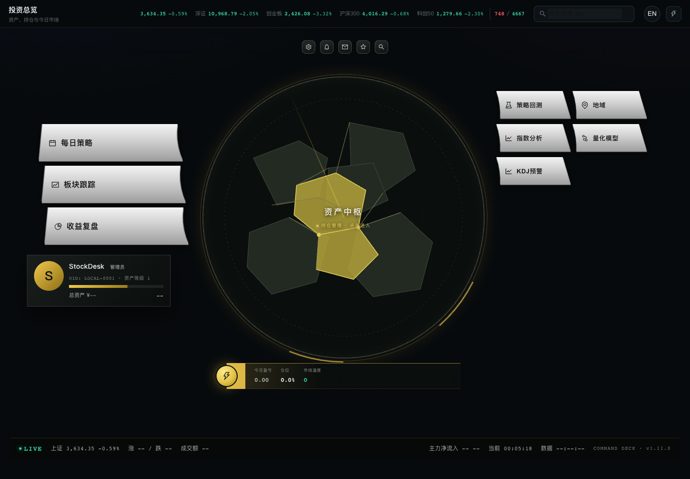

1. **HUB**：中央资产中枢，左侧每日策略/板块/复盘，右侧回测/地域/要闻/模型/KDJ；顶部是设置、异常、笔记、自选、搜索。
2. **设置账户**：齿轮 → 初始资产、管理员名称、UID。初始资产只是收益基准。
3. **记一笔交易**：进入资产中枢或持仓 → 记一笔交易（代码/方向/价格/数量/日期）。
4. **加自选**：点顶部星号，搜索代码或名称。
5. **看每日策略**：市场状态、仓位建议、今日标的、行业趋势、要闻。
6. **看模型与 KDJ**：模型看 HMM 仓位和渗流扩散；KDJ 看 5m/30m 是否进入极值区。
7. **分享**：进入任意子页面，点右下角分享，生成长图。

### 3. 页面速查

| 页面 | 看什么 | 关键动作 |
| --- | --- | --- |
| HUB | 总资产、今日盈亏、仓位、市场温度、LIVE | 点中枢进持仓；右侧进各模块 |
| 每日策略 | 市场状态、7/20/30/60 日、仓位区间、今日标的 | 先看风险，再看标的 |
| 自选 | 实时价、涨跌幅、20/60 日走势 | 搜索添加；点进个股 |
| 持股 | 成本、现价、浮动/已实现盈亏、支撑压力 | 记交易、改交易、删除 |
| 复盘 | 净值、回撤、年化、夏普、月度收益、个股贡献 | 看收益来源和风险 |
| 板块跟踪 | 行业/概念、情绪、涨停池、热图、形态 | 切换行业/概念；看资金流 |
| 策略回测 | 10 套策略、资金曲线、交易明细 | 调参数、对比基准 |
| 量化模型 | HMM、渗流最大簇、行业临界、个股建议 | 看仓位区间，不追涨杀跌 |
| 地域 | 中国上市公司地图、省份龙头、城市偏好 | 缩放地图；看省份详情 |
| 行业要闻 | 行业新闻、关键标的、投资趋势 | 结合持仓判断 |
| KDJ 预警 | 5m/30m K/D/J、RSV、MA5/20、量比、中枢 | 看极值方向和持续性 |
| 设置 | 资产、主题、缩放、语言、缓存、数据目录 | 备份前先退出 App |

### 4. 关键功能

#### 4.1 每日策略

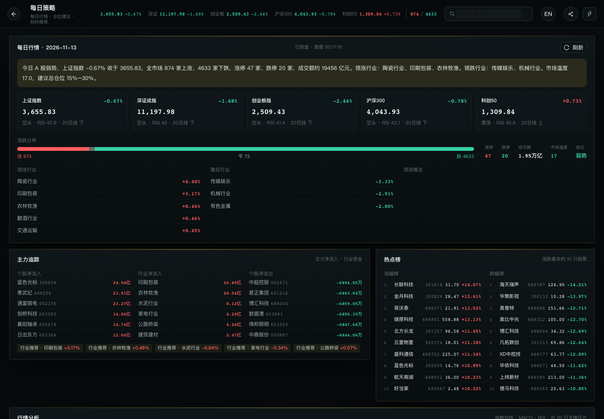

指数、涨跌家数、涨停/跌停、成交额、市场温度；7/20/30/60 日分析、MA、RSI、MACD、九转、钝化、支撑压力；行业趋势、今日标的、仓位建议、要闻。标的列表是研究候选，不是买入指令。

#### 4.2 持仓与复盘

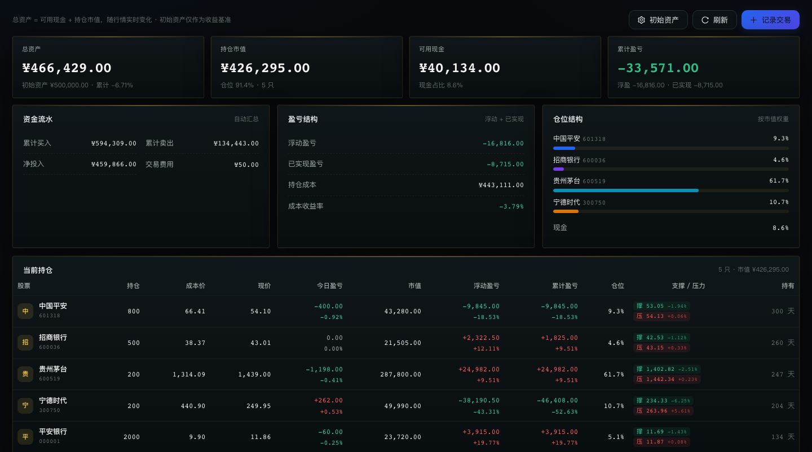

总资产 = 可用现金 + 持仓市值；移动平均成本；交易流水增删改；每只持仓的支撑/压力；单票上限和现金下限提醒。复盘含净值 vs 沪深300/上证、回撤、年化、夏普、Beta、月度热力图、FIFO 胜率、个股贡献和仓位建议。

#### 4.3 个股详情

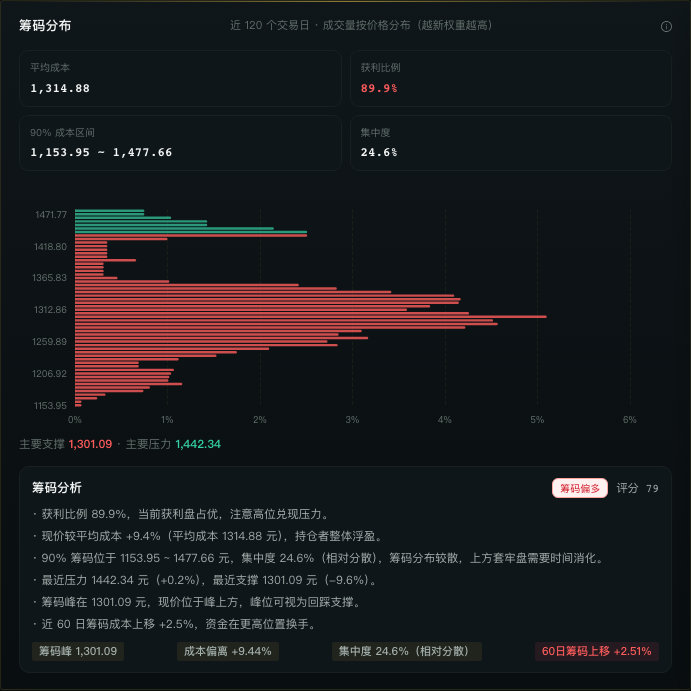

日/周/月 K、MA、成交量、MACD、九转、筹码分布、黄金分割、支撑压力、公司概况和财务指标。筹码图看平均成本、获利比例、90% 成本区间、集中度和支撑/压力。

#### 4.4 板块跟踪

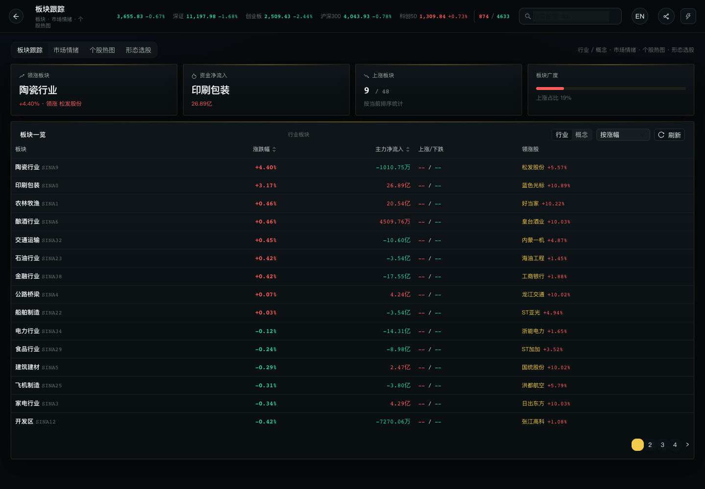

行业/概念、市场情绪、涨停池、个股热图、10 类形态选股。东方财富板块列表不可达时，行业/概念回退到新浪资金流（代码为 `SINA*`，无成分股列表），涨跌和资金流仍可用。

#### 4.5 量化模型

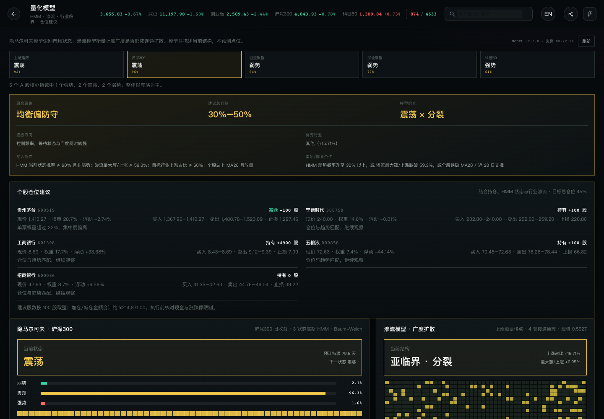

5 个 A 股核心指数的 3 状态 HMM 给总仓位；渗流找最大 4 邻接连通簇，区分普涨扩散和少数股票在动；行业临界、个股仓位建议跟随真实持仓。模型只描述现在，不预测点位。

#### 4.6 KDJ 极值预警

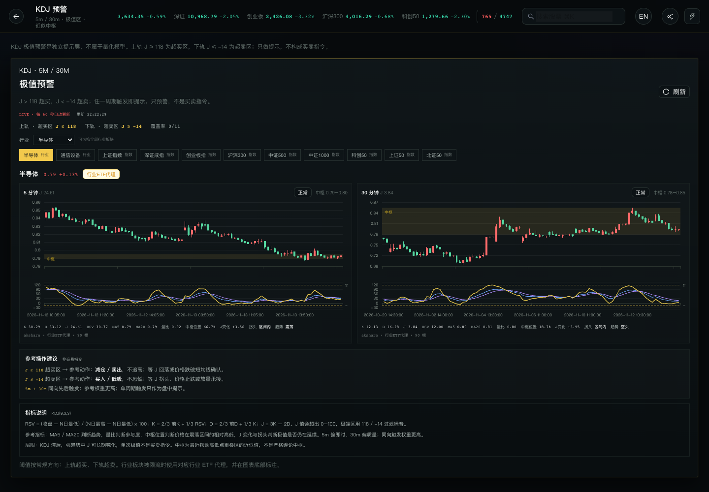

- 上轨 `J ≥ 118` 超买，下轨 `J ≤ -14` 超卖；5 分钟偏即时，30 分钟偏质量。
- 11 个标的：半导体、通信设备 + 9 个 A 股指数。
- 指标：K/D/J、RSV、MA5/20、量比、中枢位置、J 变化、拐头、趋势。
- 行业板块分钟线不可达时用并标注 ETF 代理（半导体 512480、通信设备 515880）；指数走新浪分钟线。
- 每 60 秒刷新；触发时显示深琥珀色提醒横幅。只做提示，不是交易指令。

#### 4.7 设置、分享与缩放

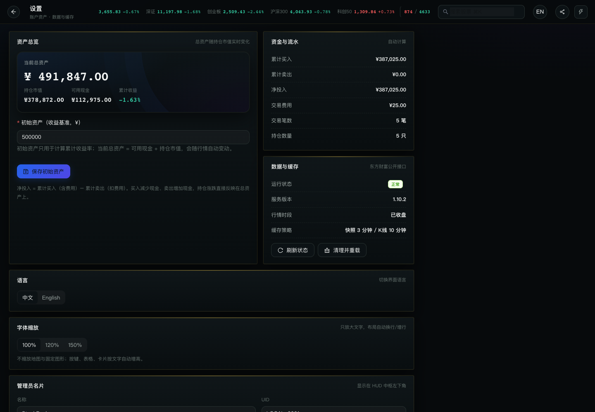

设置含初始资产、名称/UID、HUD/亮色/深色、100%/120%/150%、中文/English、缓存清理、数据目录；iOS 还有屏幕方向。缩放只放大文字，地图/图表不拉伸。子页面右下角分享按钮生成长图，HUB 首页不显示分享。

### 5. iOS 版

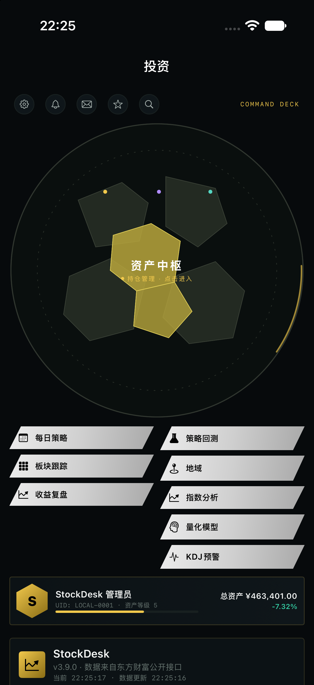

完全独立的 SwiftUI App：HUB 3+5 模块、搜索/自选/笔记/异常提醒、100%/120%/150%、横竖屏、本地 `stockdesk.json`。150% 自动单列 HUB。

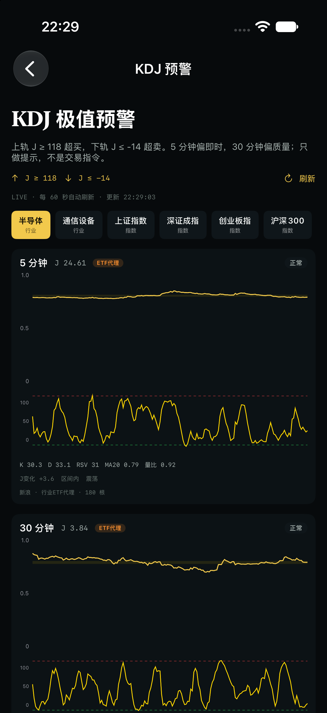

KDJ 行业卡在东方财富不可达时回退到 ETF 代理并标注；指数走新浪；北证 50 使用 `bj899050`；无数据显示「暂无」而不是「正常」。

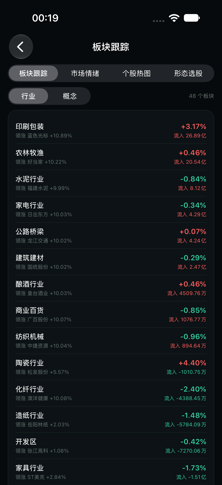

行业/概念板块回退新浪资金流；成分股仍需东方财富 BK 代码。

### 6. 美股版

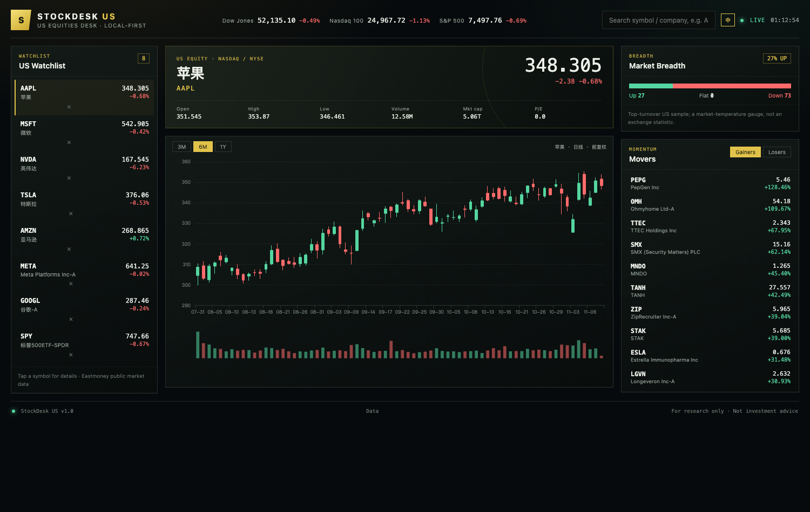

```bash
cd us && python -m venv .venv && source .venv/bin/activate
pip install -r requirements.txt && python run.py --port 8770
```

打开 <http://127.0.0.1:8770>：指数、自选、搜索、日 K、榜单、市场宽度；页面和 ECharts 本地加载。

### 7. 每天的使用顺序

```
HUB → LIVE 看指数/广度/成交额 → 每日策略定攻守 → 持仓看止损
→ 板块/情绪看扩散 → 模型看仓位 → KDJ 看极值 → 复盘记录/分享
```

不要每天频繁改仓位。HMM/渗流是风险上下文，不是买卖信号。

### 8. 数据、备份与迁移

| 平台 | 数据目录 |
| --- | --- |
| macOS | `~/Library/Application Support/StockDesk` |
| Windows | `%LOCALAPPDATA%\StockDesk` |
| iOS | App 沙盒 |
| Docker | 挂载 `/data` |

退出 App 后复制整个目录备份；恢复时先退出再放回。行情缓存可丢，账户、交易、自选、笔记和提醒最重要。

### 9. 常见问题

- **macOS 无法打开 / 已损坏**：运行 `Install-StockDesk.command`；或 `xattr -dr com.apple.quarantine /Applications/StockDesk.app`。仍被拦截到「隐私与安全性」点「仍要打开」。
- **macOS 空白页**：确认从 Applications 启动；查看 `~/Library/Application Support/StockDesk/stockdesk.log`。1.10.2 启动失败会弹原生错误提示。
- **Windows 没窗口**：装 WebView2；SmartScreen 选「更多信息 → 仍要运行」；或 `StockDesk.exe --browser`。
- **iOS 安装失败**：IPA 未签名，必须重签；免费签名 7 天过期。
- **端口被占用**：启动器自动换端口，看日志里的实际地址。
- **数据不对**：先刷新；东方财富不可达时板块/KDJ 会回退新浪/ETF 代理并标注。
- **清缓存**：设置 → 数据 → 清理行情缓存；不会删账户和交易。

### 10. 源码与打包

```bash
git clone https://github.com/cxy2696/stockdesk-akshare.git
cd stockdesk-akshare/desktop
python -m venv .venv && source .venv/bin/activate
pip install -r requirements.txt
cd frontend && npm ci && npm run build && cd ..
python main.py            # --browser 仅浏览器
```

macOS 打包：`cd desktop && VERSION=1.10.2 ./package_macos.sh`<br>
Windows 打包：`cd desktop && powershell -ExecutionPolicy Bypass -File .\build_win.ps1`

完整依赖、iOS/容器构建与发版见 [INSTALL](INSTALL.md)。

## English

### Install

| Platform | File | Size | Install |
| --- | --- | --- | --- |
| macOS 12+ Apple Silicon | `StockDesk-macOS-1.10.2.dmg` | 43 MB | Open the DMG and run `Install-StockDesk.command` |
| macOS 12+ Apple Silicon | `StockDesk-macOS-1.10.2.zip` | 42 MB | Unzip and run `Install-StockDesk.command` |
| Windows 10/11 x64 | `StockDesk.exe` | 52 MB | Double-click; WebView2; SmartScreen → More info → Run anyway |
| iPhone iOS 17+ | `StockDesk-iOS-3.7.2-unsigned.ipa` | 1.9 MB | Re-sign with Sideloadly / AltStore / Xcode |

The macOS app is ad-hoc signed. The installer clears `com.apple.quarantine`; manual fallback:

```bash
xattr -dr com.apple.quarantine /Applications/StockDesk.app
open /Applications/StockDesk.app
```

The IPA is unsigned. The macOS build is Apple Silicon only; Intel Macs should run from source or use a container.

### First five minutes


1. Open HUB: central asset hub, three left entries, five right modules, top tools.
2. Set initial assets/admin name in Settings.
3. Record a trade from Portfolio.
4. Add a watchlist symbol from the star/search.
5. Read Daily Plan: regime, position range, candidates, news.
6. Check Quant Models (HMM exposure + percolation) and KDJ alerts.
7. Share any subpage as a full-page image.

### Features and pages

- **Daily Plan**: index/breadth/limit-up/turnover/temperature; 7/20/30/60-day analysis, MA/RSI/MACD/nine-turn/support-resistance; candidates and position range.
- **Portfolio/Review**: cash + market value, moving-average cost, trades, support/resistance, NAV/drawdown/Sharpe/Beta/monthly heatmap/FIFO stats.
- **Stock detail**: candles, MA, volume, MACD, nine-turn, chips, Fibonacci, support/resistance, profile and financials.
- **Sectors**: industry/concept boards, mood, limit-up pool, heatmap, 10 pattern screeners; falls back to Sina money flow when Eastmoney is unavailable.
- **Backtest**: 10 strategies, fees/slippage, equity curve and trade list.
- **Quant Models**: 3-state HMM on five indices, percolation giant component, industry criticality, per-stock position guidance.
- **KDJ Alerts**: `J >= 118` overbought / `J <= -14` oversold; two sectors + nine indices; 5m/30m; labelled ETF proxy fallback; 60-second refresh.
- **Settings/Share**: HUD/light/dark, 100%/120%/150%, Chinese/English, cache/data folder, full-page share.

### Daily routine

```
HUB → LIVE (indices/breadth/turnover) → Daily Plan → Portfolio
→ Sectors → Quant Models → KDJ → Review
```

HMM/percolation describe the present; they are not buy/sell signals.

### Data and FAQ

Data lives in `~/Library/Application Support/StockDesk` (macOS), `%LOCALAPPDATA%\StockDesk` (Windows), the iOS app sandbox, or `/data` in Docker. Back up by copying the folder while the app is closed.

- macOS cannot open/damaged: run `Install-StockDesk.command`, or run the `xattr` command above.
- macOS blank page: launch the Applications copy and check `stockdesk.log`.
- Windows no window: install WebView2, choose Run anyway, or use `StockDesk.exe --browser`.
- iOS install fails: re-sign the IPA; free signatures expire after 7 days.
- Port in use: the launcher picks the next free port; check the log.
- Data looks wrong: refresh; sectors/KDJ fall back to Sina/ETF proxy when Eastmoney is unavailable.

### Build

```bash
cd desktop && python -m venv .venv && source .venv/bin/activate
pip install -r requirements.txt
cd frontend && npm ci && npm run build && cd ..
python main.py
```

macOS package: `VERSION=1.10.2 ./package_macos.sh`<br>
Windows package: `powershell -ExecutionPolicy Bypass -File .\build_win.ps1`

See [INSTALL](INSTALL.md) for full build/release steps. Market data is for research only, not investment advice.
