# StockDesk for iOS

[中文](#中文) · [English](#english)

使用流程与常见问题：[使用教程与流程](../docs/GUIDE.md) · Walkthrough: [Guide & Workflow](../docs/GUIDE.md).

## 中文

完全独立的原生 iOS 股票投资 App：**不依赖 Mac 后端**，行情、K 线、财务、持仓、复盘、回测、选股、提醒全部在 iPhone 本地完成。
SwiftUI + Swift Charts，默认 **「指挥舱 HUD」** 深色界面，也可切换明亮/深色；设置内可切换中文 / English。

**v3.7.2**：HUB 精简为 3+4；分享只在进入子页面后出现，滚动内容自动拼接为完整长图，可经系统分享到微信/Notes；HMM/渗流新增个股建议、行业临界和最大连通簇理由；资产快照缓存；资产分析含资金分配、交易偏好、趋势与交易习惯；投资建议含历史总结、未来趋势与标的推荐；指数分析覆盖 7 个指数；顶部放大镜/星号/信封/铃铛；底部显示当前时间与数据更新时间。，持仓、复盘、总览、自选、回测、设置全部收进「投资」；K 线可拖动查看每日数据；公司概况补全；九转/底部钝化、7/20/30/60 日分析、行业趋势、行情要闻与指标说明。

| 每日策略（多周期/行业） | 板块跟踪 | 投资 HUD |
| --- | --- | --- |
| 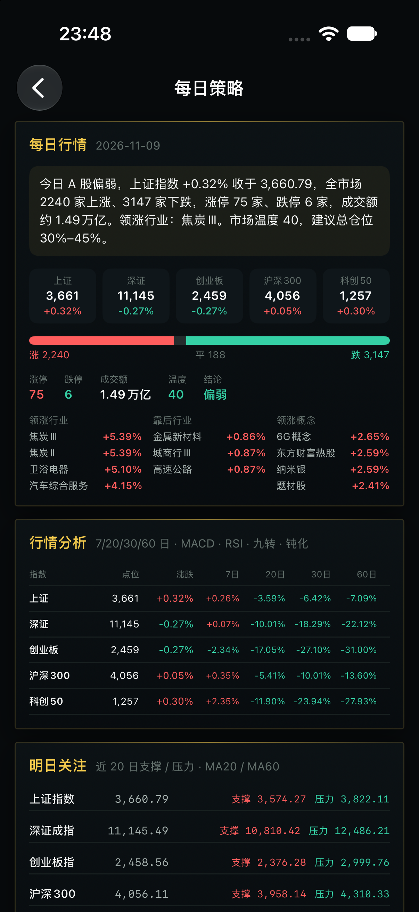 | 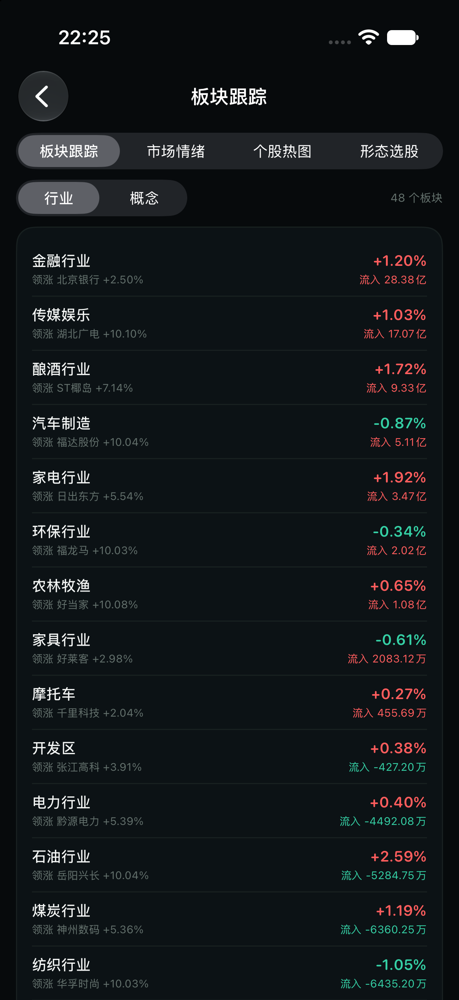 | 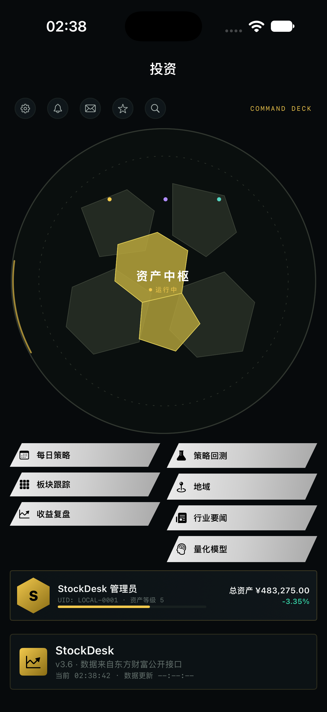 |

| 指数分析 | 投资 HUD 横屏 | 设置（主题 / 横屏） |
| --- | --- |
| 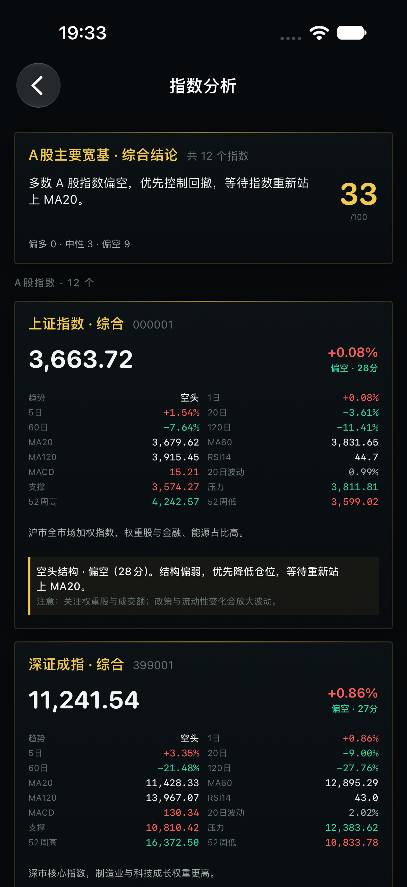 | 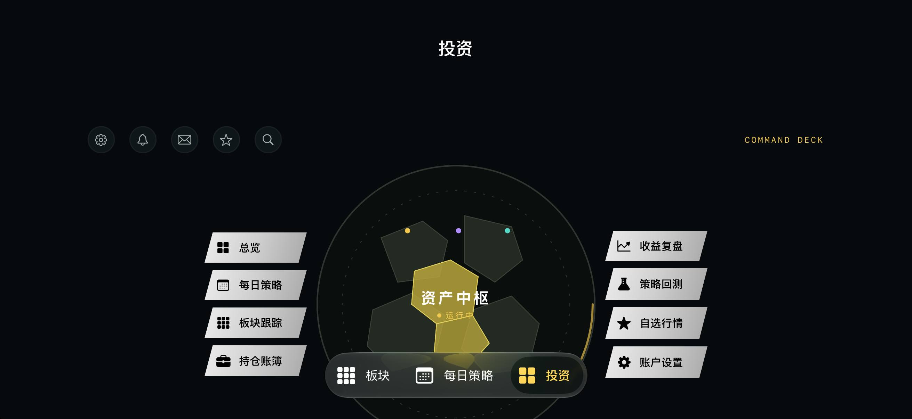 | 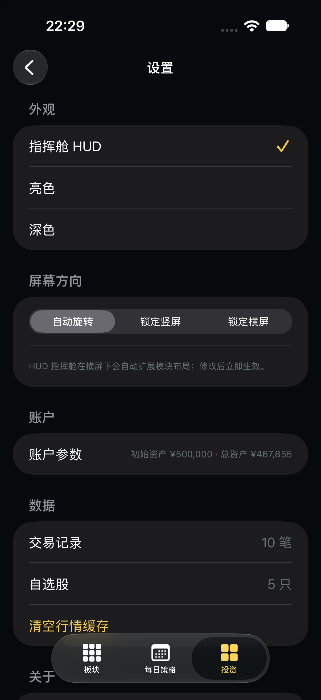 |

| 设置（主题 / 横屏） |
| --- |
|  |

| 个股热图 | 黄金分割 + 筹码 | 复盘总结 |
| --- | --- | --- |
| 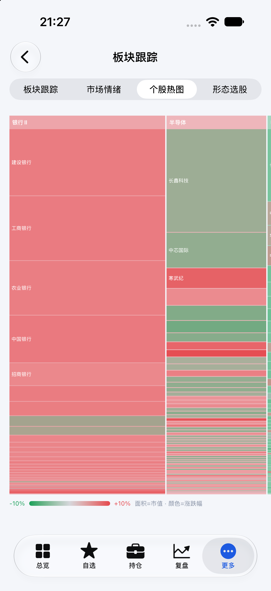 | 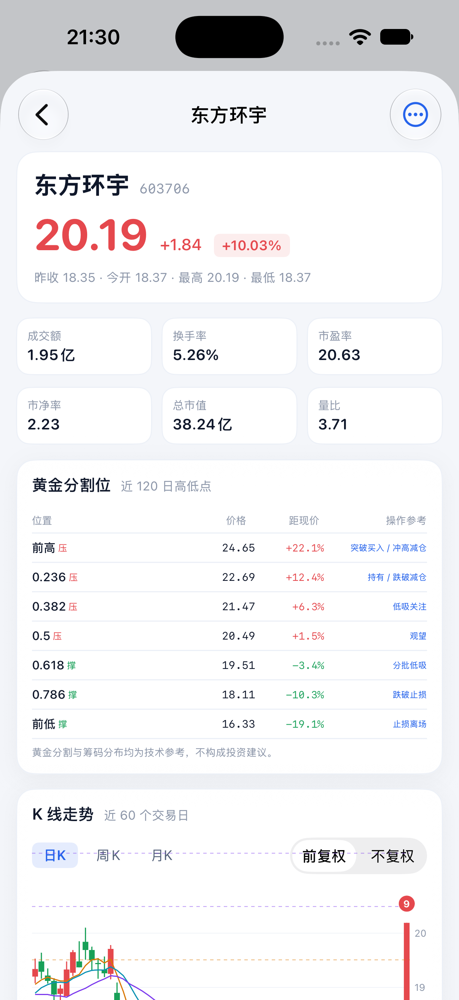 | 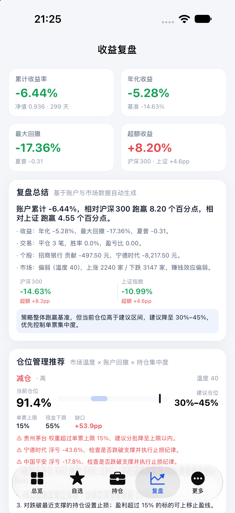 |

| 持仓（撑/压） | 自选（20/60 日） | 回测 |
| --- | --- | --- |
| 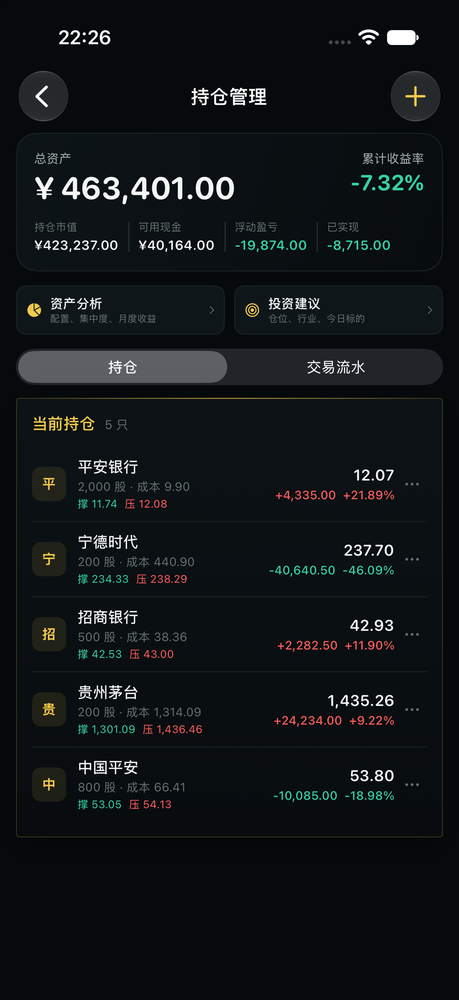 | 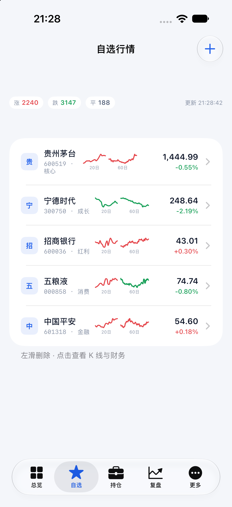 | 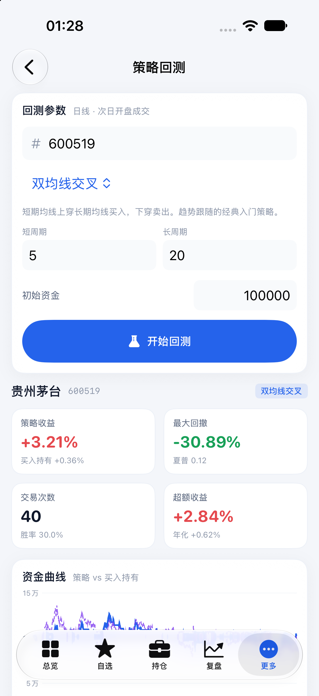 |

---

## 交付物

| 文件 | 用途 |
| --- | --- |
| `dist/StockDesk-unsigned.ipa` | 未签名 IPA，用 Sideloadly / AltStore / Xcode 签名安装到真机 |
| `dist/StockDesk-simulator.app` | 已编译 App，可直接装进 iOS 模拟器 |
| `StockDesk.xcodeproj` | Xcode 工程，真机安装最稳妥的方式 |

> App 完全离线于你的数据：不登录、不上传，账户数据保存在 App 沙盒内。

## 安装到 iPhone（本地运行）

> 本仓库提供的是**未签名 IPA**，iOS 不允许直接安装未签名 App，需要用你的 Apple ID 重签一次。不需要 Mac 后端，安装后所有数据都在手机本地。

### 方式 A：Xcode 直接跑真机（推荐，免费 Apple ID 即可）

1. 用 Xcode 打开 `StockDesk.xcodeproj`
2. 选中 `StockDesk` target → Signing & Capabilities → Team 选择你的 Apple ID（没有就 Add Account）
3. Bundle Identifier 改成唯一值（如 `com.你的名字.stockdesk`）
4. 连上 iPhone，选中设备，⌘R 运行
5. 首次运行到 iPhone「设置 → 通用 → VPN 与设备管理」信任你的开发者证书

免费 Apple ID 签名的 App 有效期为 7 天，到期重新运行一次即可。

### 方式 B：侧载 IPA

1. 把 `dist/StockDesk-unsigned.ipa` 传到电脑
2. 用 [Sideloadly](https://sideloadly.io) 或 AltStore / SideStore 登录 Apple ID 重签并安装
3. 在 iPhone「设置 → 通用 → VPN 与设备管理」信任证书

也可以在有 Apple ID 的 Mac 上运行：

```bash
./install_to_iphone.sh <你的 Team ID>
```

Team ID 在 Xcode → Settings → Accounts → 选中 Apple ID → Team ID 查看。

### 方式 C：先装到模拟器（无需签名）

```bash
xcrun simctl boot "iPhone 18 Pro"   # 或任意已安装的模拟器
xcrun simctl install booted dist/StockDesk-simulator.app
xcrun simctl launch booted com.stockdesk.app
```

## 功能

- **总览**：总资产、持仓市值、可用现金、今日盈亏、浮动/已实现盈亏、累计收益率、账户净值迷你曲线、自选列表、涨幅/资金流榜
- **自选**：实时价格与涨跌幅、搜索添加（代码/名称）、左滑删除、涨跌家数
- **个股**：实时报价、日/周/月 K 线（MA5/10/20 + 成交量 + **MACD 副图**）、**拖动查看每日 OHLC/涨跌**、**九转序列 9 标记**、**筹码分布与筹码分析**、**黄金分割位**、支撑/压力、**完整公司概况（董事长/董秘/法人/地址/网站/主营/经营范围等）**、近 8 期财务指标
- **投资**：总览、自选、持仓、复盘、回测、设置统一收进「投资」页
- **持仓**：**总资产 = 可用现金 + 持仓市值**、初始资产基准、移动平均成本、数量、成本价、现价、浮动盈亏、仓位、**每只持仓的支撑/压力**；**单笔删除交易、整只删除持仓（带确认）**；交易流水增删改
- **复盘**：**复盘总结、仓位管理推荐、趋势分析（净值 vs 20/60 日线）、行情判断、市场情况**、净值曲线（沪深300 + 上证双基准）、回撤、累计/年化/超额收益、夏普、Beta、月度收益热力图、FIFO 胜率/盈亏比、个股贡献
- **回测**：双均线、动量突破、RSI、MACD、布林带、唐奇安通道、均线+RSI、布林突破、KDJ、放量突破 **10 套策略**；次日开盘成交、手续费/印花税/滑点、资金曲线与完整交易明细
- **每日策略**：每日行情、主力追踪、热点榜（涨跌前 10）、行情分析（7/20/30/60 日 + MA5/10/20/60 + RSI + MACD + 九转 + 底部钝化 + 支撑压力）、行业趋势、行情要闻、指标说明、仓位管理推荐、今日标的
- **板块跟踪**：行业/概念板块、市场情绪与涨停池、全市场个股热图、10 类形态选股
- **自选**：20 日 / 60 日迷你走势、涨跌家数、搜索添加
- **本地运行**：无服务器、无登录、无上传；行情来自东方财富公开接口，账户数据保存在 App 沙盒
- **横竖屏**：设置 → 账户与主题 → 屏幕方向，可选自动旋转 / 锁定竖屏 / 锁定横屏，立即生效
- **指挥舱 HUD**：取消底部选择，14 个银色模块；底部 StockDesk 卡片显示当前时间（秒）与数据更新时间
- **顶栏交互**：放大镜搜索股票名称/代码、星号自选、信封笔记、铃铛异常提醒
- **资产中枢**：中国上市公司分布地图（5,570 家 / 31 地区），双指缩放；地域概览下方可折叠查看全部省份领涨公司；下方直达资产分析、投资建议、指数分析
- **新增 HUB 入口**：地域（全部省份/城市行业偏好）、行业要闻（行业情况分析与投资趋势）、量化模型
- **量化模型**：5 个 A 股核心指数 HMM 切换；个股仓位/买卖建议；行业临界、关键标的、细分行业渗流、随机重排稳健性
- **KDJ 预警**：半导体 / 通信设备 + 9 个 A 股指数，5m / 30m 的 K/D/J、RSV、MA5/20、量比与近似中枢；板块分钟数据不可达时自动使用并标注 ETF 代理，不再停在「暂无行情」
- **稳定性**：资产快照本地缓存，启动先展示上次资产再刷新
- **分享**：HUD 顶栏及详情页浮动按钮可分享当前界面截图
- **界面缩放**：设置 → 界面缩放，支持 100% / 120% / 150%；120% 两列，150% 自动切单列 HUB，全部页面同步
- **管理员名片**：名称与 UID 在设置中修改，立即同步到中枢左下角
- **异常提醒**：页面顶部列出 5 条触发条件，并给出当前命中项
- **添加自选**：热门展示涨速最高的 10 只股票（名称、代码、行业、涨速）
- **竖版/横版**：竖版地图+2 列模块，横版左右三栏

## 数据与隐私

- 行情、K 线、指数、财务数据来自**东方财富公开接口**（与桌面版同源）。
- 账户、交易、自选、提醒保存在 App 沙盒的 `stockdesk.json`，卸载即删除。
- 行情缓存位于沙盒 Caches，设置页可一键清空。
- 所有数据仅在设备本地处理，无任何上传。

## 架构

```
StockDesk/
├── StockDeskApp.swift        # App 入口 + 主题
├── Models/Models.swift       # Quote / KLine / Trade / Position / Backtest 等
├── Services/
│   ├── Networking.swift      # URLSession + 磁盘 TTL 缓存
│   ├── MarketService.swift   # 东财行情/K线/财务/指数/搜索/榜单
│   ├── AppStore.swift        # 本地持久化 + 状态编排
│   ├── PortfolioEngine.swift # 移动平均成本、净值、回撤、FIFO 统计
│   ├── BacktestEngine.swift  # 5 种策略 + 指标 + 回测撮合
│   ├── ScreenerEngine.swift  # 多因子筛选与评分
│   └── Theme.swift           # 亮色设计系统
└── Views/                    # SwiftUI 页面与组件（Swift Charts）
```

## 重新构建

```bash
./build_ios.sh
```

依赖：Xcode 15+、XcodeGen（`brew install xcodegen`）。

## 已知限制

- 仅支持 A 股；港股/美股/基金未覆盖。
- 价格提醒仅在 App 前台运行时检查（iOS 后台限制），后续可接本地通知做定时检查。
- 回测为单标的全仓模型，不处理停牌、涨跌停无法成交等情况。
- 行情来自公开接口，可能有延迟，交易请以券商行情为准。
- 未签名 IPA 需要自行重签；上架 App Store 需要 Apple Developer 付费账号并走 Archive/TestFlight 流程。

## License

个人学习与研究用途，不构成投资建议。


---


## English

StockDesk for iOS is a fully standalone SwiftUI app. It does **not** require the Mac backend: quotes, candles, fundamentals, portfolio, review, backtest, screening and alerts all run on the iPhone.

- SwiftUI + Swift Charts
- HUB home with three left actions and four right modules
- 100% / 120% / 150% font scaling; 150% uses a single-column HUB
- Built-in Chinese / English switch in Settings
- Full-page image sharing via the system share sheet (WeChat, Notes, Files)
- HMM and percolation models with per-stock position guidance
- KDJ extreme-zone panel for two sectors and nine A-share indices, with 5m / 30m K/D/J, RSV, MA5/20, volume ratio and an approximate central zone; a labelled ETF proxy keeps sector cards live when board-minute data is unavailable
- Local-only storage; no login and no uploads

### Install

1. Open `StockDesk.xcodeproj`
2. Select your team under Signing & Capabilities
3. Run on a simulator or a device

The unsigned IPA can be re-signed with Sideloadly, AltStore or Xcode. A free Apple ID signature expires after 7 days.

